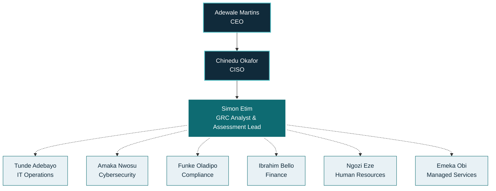

# 🛡️ Solari Technologies Ltd.

### `Business Context and Scope Document`

**Enterprise Cybersecurity Risk Assessment**

## 1. Executive Summary

This document defines the business context, objectives and scope of an enterprise cybersecurity risk assessment for Solari Technologies Ltd., a technology and IT consulting company based in Lagos, Nigeria, with 150 employees.

**Simon Etim, GRC Analyst and Assessment Lead**, is responsible for coordinating this simulated assessment, identifying cybersecurity risks, evaluating their business impact and developing risk treatment recommendations.

The assessment aims to strengthen information security governance, protect business and client information, and support reliable IT service delivery.

---

## 2. Organisational Context

| 🏢 Business Information | Details |
|---|---|
| **Company** | Solari Technologies Ltd. |
| **Industry** | Technology and IT Consulting |
| **Location** | 📍 Lagos, Nigeria |
| **Workforce** | 👥 150 Employees |
| **Business Model** | IT Consulting and Managed Technology Services |

### 🧰 Key Business Activities

For this simulated assessment, Solari's operations include:

- 🖧 IT infrastructure consulting and technical support.
- 🔐 Cybersecurity consulting and managed security services.
- ☁️ Cloud solutions and systems administration.
- 🌐 Network deployment and management.
- 💬 IT advisory and client support.

### 🎯 Business Priorities

- Protect confidential company and client information.
- Maintain reliable IT service delivery.
- Minimise cybersecurity incidents and operational downtime.
- Meet applicable regulatory and contractual obligations.
- Strengthen customer trust and business resilience.

---

## 3. GRC Analyst's Role and Responsibilities

**Assessment Lead: Simon Etim**

As the GRC Analyst leading this portfolio assessment, my responsibilities include:

1. Define the risk assessment scope and methodology.
2. Identify and classify critical information assets.
3. Assess cybersecurity threats, vulnerabilities and potential business impacts.
4. Evaluate security controls and identify gaps.
5. Develop and maintain the cybersecurity risk register.
6. Recommend risk treatment strategies and proposed risk owners.
7. Map relevant risks and controls to security frameworks.
8. Prepare assessment findings and management reports.

> [!TIP]
> **Expected Outcome:** A documented, risk-based assessment that supports management decision-making and continuous security improvement.

---

## 4. Assessment Objectives

The assessment aims to:

- Identify critical business processes and information assets.
- Identify relevant cybersecurity threats and vulnerabilities.
- Evaluate existing or assumed security controls.
- Assess risk likelihood and business impact.
- Prioritise risks and recommend treatment measures.
- Establish risk ownership and reporting requirements.

---

## 5. Assessment Scope

### ✅ In-Scope Areas

| Area | Assessment Focus |
|---|---|
| 🖥️ **IT Infrastructure** | Servers, networks, firewalls and endpoints |
| 🪪 **Identity & Access Management** | User accounts, privileged access and authentication |
| ☁️ **Cloud Services** | Cloud configurations, security and access |
| 📂 **Client Information** | Confidentiality, storage and access controls |
| 🛠️ **Managed IT Services** | Remote administration and service delivery |
| 💾 **Backup & Recovery** | Data availability and recovery capabilities |
| 🤝 **Third-Party Services** | Vendor security and service dependencies |
| 📡 **Security Operations** | Monitoring, incident detection and response |

### 🚫 Out-of-Scope Areas

- Physical security assessments.
- Penetration testing and exploitation.
- Source-code security reviews.
- Unauthorised assessment of client systems.
- Financial and statutory audits.

---

## 6. Key Stakeholders and Responsibilities

| Name | Position | Responsibility |
|---|---|---|
| **Simon Etim** | **GRC Analyst / Assessment Lead** | **Coordinate assessment activities, evaluate risks, maintain documentation and report findings.** |
| Adewale Martins | Chief Executive Officer | Executive oversight and strategic direction |
| Chinedu Okafor | Chief Information Security Officer | Cybersecurity governance and assessment review |
| Tunde Adebayo | IT Operations Manager | Infrastructure information and technical risk support |
| Amaka Nwosu | Cybersecurity Team Lead | Threat identification and security control evaluation |
| Ngozi Eze | Head of Human Resources | Employee data and access management |
| Ibrahim Bello | Finance Manager | Financial exposure and business impact |
| Funke Oladipo | Compliance Officer | Regulatory compliance and policy alignment |
| Emeka Obi | Managed Services Manager | Client service delivery and operational risks |

*All stakeholder names and roles, except Simon Etim, are fictional and used for this portfolio simulation.*

### Assessment Governance Structure

*Dashed lines represent assessment collaboration, not direct reporting relationships.*

---

## 7. Risk Assessment Methodology

The assessment will follow ISO 31000 and ISO/IEC 27005 risk management principles, supported by ISO/IEC 27001 and NIST CSF 2.0.

Risk ratings will be determined using a defined likelihood and impact scoring methodology.

---

## 8. Regulatory and Compliance Considerations

The assessment will consider:

- Nigeria Data Protection Act (NDPA) 2023.
- Applicable Nigeria Data Protection Commission regulations and guidance.
- Cybercrimes Act 2015, as amended in 2024.
- ISO/IEC 27001.
- NIST Cybersecurity Framework 2.0.

Applicable legal obligations will be distinguished from voluntary security frameworks.

---

## 9. Expected Deliverables

- [ ] Information Asset Inventory
- [ ] Risk Assessment Methodology
- [ ] Threat and Vulnerability Assessment
- [ ] Cybersecurity Risk Register
- [ ] Risk Heat Map
- [ ] Risk Treatment Plan
- [ ] Executive Risk Assessment Report

---

## 10. Assumptions and Limitations

This assessment is a simulated portfolio exercise. Technology systems, business processes, organisational structures and security controls are based on hypothetical scenarios unless otherwise verified.

> [!WARNING]
> No live systems or client environments have been assessed. Findings must not be presented as actual security weaknesses within Solari Technologies Ltd.

---

## 11. Review and Approval

| Name | Role | Status |
|---|---|---|
| **Simon Etim** | **GRC Analyst / Assessment Lead** | **🟢 Draft Prepared** |
| Tunde Adebayo | IT Operations Manager | 🟡 Pending Review |
| Amaka Nwosu | Cybersecurity Team Lead | 🟡 Pending Review |
| Chinedu Okafor | Chief Information Security Officer | ⚪ Approval Not Obtained |

*Review and approval statuses are illustrative; no actual management approval is claimed.*

---

> This document was developed by Simon Etim as an independent, simulated GRC portfolio project. The organisation's assumed operations, fictional management team, risk scenarios and assessment activities do not constitute an official cybersecurity assessment or verified findings.
