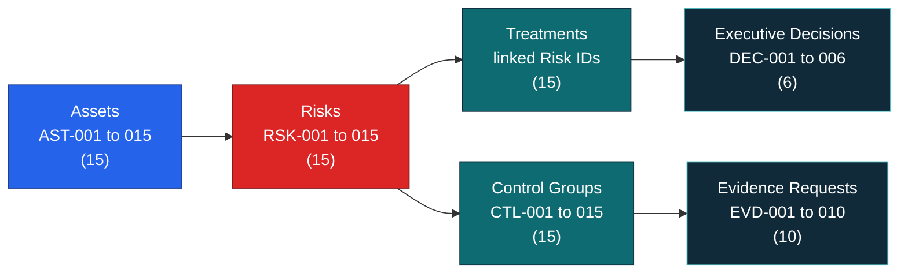

<a id="top"></a>

<div align="center">

# 🛡️ Solari Technologies Ltd.

### Project Documentation & Final Quality Review

**Phase 10 · Enterprise Cybersecurity Risk Assessment**


[Baseline](#3-assessment-baseline) · [Traceability](#4-risk-traceability-requirements) · [Quality Review](#5-documentation-quality-review) · [Publication Checklist](#7-portfolio-publication-requirements) · [Outstanding Work](#8-outstanding-assessment-activities) · [Completion](#9-project-completion-statement)

</div>

> [!IMPORTANT]
> This document sets out proposed quality review and publication requirements. It does not claim that an independent audit, actual management review or formal organisational approval has been completed. See the [Portfolio Disclaimer](#portfolio-disclaimer).

---

## 1. Executive Summary

This document establishes the final documentation and quality review requirements for the simulated Enterprise Cybersecurity Risk Assessment of Solari Technologies Ltd.

The review framework was prepared by **Simon Etim, GRC Analyst and Assessment Lead**, to promote consistency, completeness, traceability and professional presentation across the assessment deliverables.

---

## 2. Quality Review Objectives

The quality review aims to:

- Confirm consistency across assessment documentation.
- Verify risk scoring calculations and classifications.
- Maintain traceability between assets, risks, controls and treatments.
- Confirm appropriate disclosure of assessment limitations.
- Establish document control and version management.
- Prepare the project for professional portfolio publication.

---

## 3. Assessment Baseline

| Review Metric | Expected Result |
|---|:-:|
| Information Assets | **15** |
| Cybersecurity Risk Scenarios | **15** |
| 🔴 Critical Risks | **4** |
| 🟠 High Risks | **10** |
| 🟡 Medium Risks | **1** |
| 🟢 Low Risks | **0** |
| Total Inherent Risk Scores | **220** |
| Average Inherent Risk Score | **14.67** |
| Proposed Treatment Entries | **15** |
| Proposed Control Assessment Groups | **15** |
| Validated Residual Risk Ratings | **0** |

> [!NOTE]
> These values establish the expected reconciliation baseline from the previously documented risk register.

<details>
<summary><b>Show how the total of 220 reconciles</b></summary>

<br>

Risks are grouped by score. Each group's subtotal is the score multiplied by the number of risks at that score.

| Inherent Score | Risk Level | Risks | Subtotal |
|:-:|:-:|:-:|:-:|
| 20 | 🔴 Critical | 4 | 80 |
| 16 | 🟠 High | 2 | 32 |
| 15 | 🟠 High | 1 | 15 |
| 12 | 🟠 High | 7 | 84 |
| 9 | 🟡 Medium | 1 | 9 |
| **Total** | | **15** | **220** |

```text
Average inherent score = 220 ÷ 15 = 14.67
```

Level counts: 4 Critical (score 20) + 10 High (scores 12 to 16) + 1 Medium (score 9) = 15 risks.

</details>

---

## 4. Risk Traceability Requirements

Each component of the assessment should link to the next, so that any risk can be followed from asset to decision.



| Assessment Component | Identifier | Expected Coverage |
|---|---|:-:|
| Information Assets | `AST-001` to `AST-015` | 15 assets |
| Cybersecurity Risks | `RSK-001` to `RSK-015` | 15 risks |
| Risk Treatment Entries | Linked Risk IDs | 15 entries |
| Control Assessment Groups | `CTL-001` to `CTL-015` | 15 groups |
| Priority Evidence Requests | `EVD-001` to `EVD-010` | 10 initial requests |
| Executive Decisions | `DEC-001` to `DEC-006` | 6 proposed decisions |
| Assessment Documents | `SOL-GRC-RA-001` to `SOL-GRC-RA-010` | 10 documents |

> [!NOTE]
> The evidence request register is an initial priority list and does not represent complete evidence coverage.

---

## 5. Documentation Quality Review

| Review Area | Document | Quality Requirement | Status |
|---|:-:|---|:-:|
| **Business Context** | [001](SOL-GRC-RA-001-Business-Context-and-Scope.md) | Consistent organisational assumptions | 🟡 Pending Final Verification |
| **Asset Inventory** | [002](SOL-GRC-RA-002-Information-Asset-Inventory.md) | Unique asset identifiers and ownership | 🟡 Pending Final Verification |
| **Risk Methodology** | [003](SOL-GRC-RA-003-Risk-Assessment-Methodology.md) | Consistent likelihood and impact scales | 🟡 Pending Final Verification |
| **Risk Register** | [005](SOL-GRC-RA-005-Cybersecurity-Risk-Register.md) | Accurate scoring and risk classification | 🟡 Pending Final Verification |
| **Risk Heat Map** | [006](SOL-GRC-RA-006-Risk-Heat-Map.md) | Alignment with risk register | 🟡 Pending Final Verification |
| **Risk Treatment Plan** | [007](SOL-GRC-RA-007-Risk-Treatment-Plan.md) | Traceable treatment recommendations | 🟡 Pending Final Verification |
| **Executive Report** | [008](SOL-GRC-RA-008-Executive-Risk-Assessment-Report.md) | Accurate management-level summaries | 🟡 Pending Final Verification |
| **Control Validation** | [009](SOL-GRC-RA-009-Control-Validation-and-Residual-Risk-Assessment.md) | Clear testing and evidence requirements | 🟡 Pending Final Verification |
| **Residual Risk** | [009](SOL-GRC-RA-009-Control-Validation-and-Residual-Risk-Assessment.md) | No unsupported risk reductions | 🟡 Pending Final Verification |
| **Document Control** | All | Consistent IDs, versions and review status | 🟡 Pending Final Verification |
| **Portfolio Presentation** | [README](README.md) | Clear navigation and readable documentation | 🟡 Pending Publication |

---

## 6. Standard Risk Classification

| Score | Risk Level | Colour Code |
|:-:|:-:|:-:|
| 1–4 | 🟢 **Low** | `#16A34A` |
| 5–9 | 🟡 **Medium** | `#EAB308` |
| 10–16 | 🟠 **High** | `#F97316` |
| 17–25 | 🔴 **Critical** | `#DC2626` |

> [!TIP]
> All assessment documents, workbook calculations, dashboards and visualisations should apply these thresholds consistently.

---

## 7. Portfolio Publication Requirements

Before publishing the project, work through this checklist. Tick a box only when the check has actually been completed.

**Progress: 0 of 10 complete** `▱▱▱▱▱▱▱▱▱▱`

- [ ] Confirm that all required documents are available.
- [ ] Verify all risk score calculations.
- [ ] Reconcile the workbook against the Markdown documents.
- [ ] Confirm consistent risk ownership assignments.
- [ ] Verify document links and repository navigation.
- [ ] Check Mermaid diagram rendering.
- [ ] Review workbook formulas and conditional formatting.
- [ ] Remove any confidential or unnecessary personal information.
- [ ] Confirm that all fictional scenarios are appropriately disclosed.
- [ ] Review spelling, formatting and professional presentation.

*Copy this checklist into a GitHub issue or project board to track completion.*

---

## 8. Outstanding Assessment Activities

| Outstanding Activity | Reason | Status |
|---|---|:-:|
| **Actual Control Testing** | No organisational testing environment | 🟡 Pending |
| **Evidence Collection** | No actual organisational evidence available | 🟡 Pending |
| **Residual Risk Assessment** | Control effectiveness not established | 🟡 Pending |
| **Treatment Deadlines** | No formal management agreement | 🟡 Pending |
| **Risk Acceptance** | No authorised management decision | 🟡 Pending |
| **Workbook Reconciliation** | Requires independent workbook review | 🟡 Pending |
| **GitHub Publication** | Requires repository upload and verification | 🟡 Pending |

> [!NOTE]
> These limitations do not prevent the project from demonstrating a simulated risk assessment methodology.

---

## 9. Project Completion Statement

The documentation development phase of the simulated Enterprise Cybersecurity Risk Assessment has been completed in draft form.

The project demonstrates a structured approach to business context establishment, information asset identification, cybersecurity risk assessment, risk prioritisation, treatment planning, executive reporting and control assurance planning.

> [!WARNING]
> Actual security control validation, residual risk determination and formal management acceptance remain outside the completed activities.

Final portfolio publication is subject to document reconciliation and quality verification.

---

## 10. Review and Approval

| Name | Role | Status |
|---|---|---|
| **Simon Etim** | **GRC Analyst & Assessment Lead** | **🟢 Draft Prepared** |
| Funke Oladipo | Compliance Officer | 🟡 Simulated Review Pending |
| Chinedu Okafor | Chief Information Security Officer | ⚪ Approval Not Obtained |
| Adewale Martins | Chief Executive Officer | ⚪ Approval Not Obtained |

---

## 11. Document Control

| Version | Date | Description |
|:-:|---|---|
| 1.0 | 24 November 2026 | Initial project documentation and final quality review framework |

### Assessment Document Set

| # | Document ID | Document | Read |
|:-:|---|---|:-:|
| 01 | `SOL-GRC-RA-001` | Business Context and Scope | [Open](SOL-GRC-RA-001-Business-Context-and-Scope.md) |
| 02 | `SOL-GRC-RA-002` | Information Asset Inventory & Classification | [Open](SOL-GRC-RA-002-Information-Asset-Inventory.md) |
| 03 | `SOL-GRC-RA-003` | Cybersecurity Risk Assessment Methodology | [Open](SOL-GRC-RA-003-Risk-Assessment-Methodology.md) |
| 04 | `SOL-GRC-RA-004` | Threat and Vulnerability Assessment | [Open](SOL-GRC-RA-004-Threat-and-Vulnerability-Assessment.md) |
| 05 | `SOL-GRC-RA-005` | Enterprise Cybersecurity Risk Register | [Open](SOL-GRC-RA-005-Cybersecurity-Risk-Register.md) |
| 06 | `SOL-GRC-RA-006` | Cybersecurity Risk Heat Map & Analysis | [Open](SOL-GRC-RA-006-Risk-Heat-Map.md) |
| 07 | `SOL-GRC-RA-007` | Enterprise Cybersecurity Risk Treatment Plan | [Open](SOL-GRC-RA-007-Risk-Treatment-Plan.md) |
| 08 | `SOL-GRC-RA-008` | Executive Cybersecurity Risk Assessment Report | [Open](SOL-GRC-RA-008-Executive-Risk-Assessment-Report.md) |
| 09 | `SOL-GRC-RA-009` | Security Control Validation & Residual Risk Assessment | [Open](SOL-GRC-RA-009-Control-Validation-and-Residual-Risk-Assessment.md) |
| 10 | `SOL-GRC-RA-010` | Project Documentation & Final Quality Review | This document |
| – | Workbook | SOL-GRC-RA-Risk-Assessment-Workbook.xlsx | [Open](SOL-GRC-RA-Risk-Assessment-Workbook.xlsx) |


[Back to top](#top)

</div>
