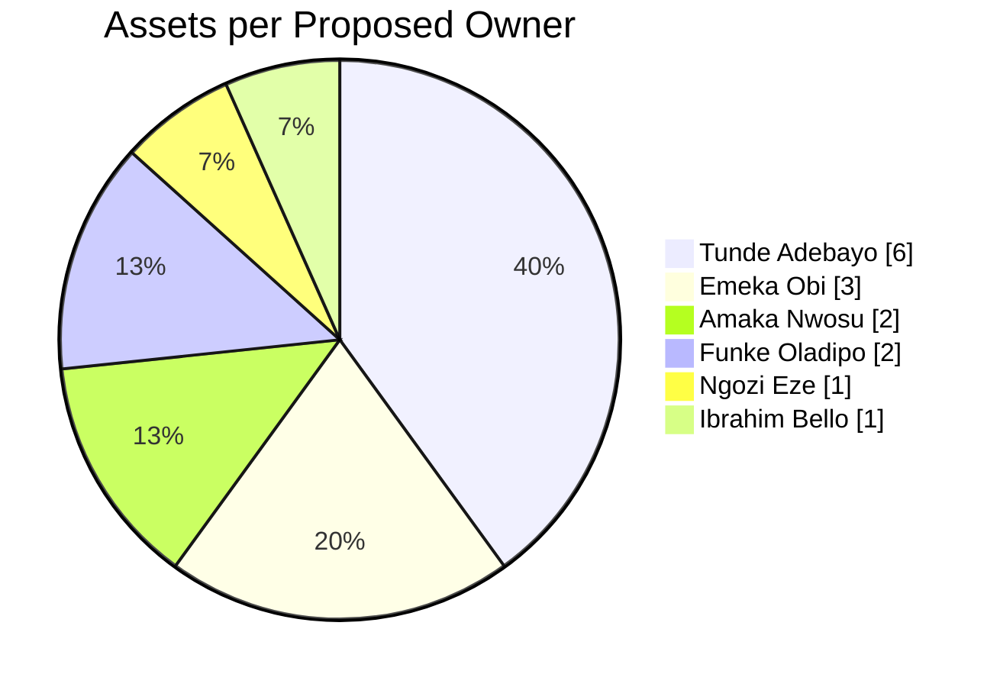
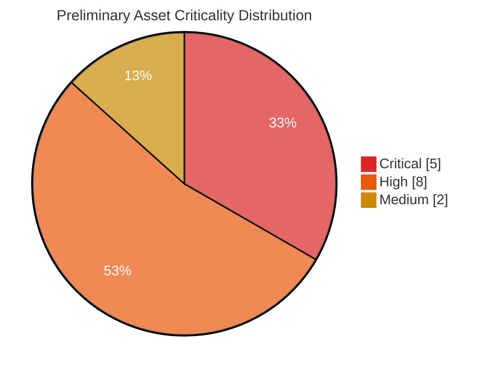

<div align="center">

# 🛡️ Solari Technologies Ltd.

### `Information Asset Inventory & Classification`

**Phase 02 · Enterprise Cybersecurity Risk Assessment**


</div>

## 1. Executive Summary

This document presents a preliminary inventory of information assets supporting the assumed operations of Solari Technologies Ltd., a technology and IT consulting company based in Lagos, Nigeria, with 150 employees.

As the GRC Analyst and Assessment Lead, **Simon Etim** is responsible for coordinating asset identification, proposing classifications, documenting asset ownership and evaluating business criticality.

The inventory will support cybersecurity risk identification, control assessment, risk treatment planning and information security governance.

> [!NOTE]
> **Assessment boundary:** All assets, ownership assignments and criticality ratings are simulated and require validation before use in an actual organisational assessment.

---

## 2. Objectives

The asset inventory aims to:

1. Identify critical information assets and supporting systems.
2. Document the business purpose of each asset.
3. Assign proposed asset owners.
4. Classify information based on sensitivity.
5. Assess business criticality and security requirements.
6. Establish a baseline for cybersecurity risk assessment.

---

## 3. Asset Classification Framework

### 3.1 Information Classification Levels

| Classification | Description | Examples |
|---|---|---|
| 🟢 **Public** | Information approved for public disclosure | Published marketing materials |
| 🔵 **Internal** | Business information intended for authorised employees | Internal procedures |
| 🟠 **Confidential** | Sensitive business or personal information requiring restricted access | Client contracts, HR records |
| 🔴 **Restricted** | Highly sensitive information requiring enhanced safeguards | Privileged credentials, cryptographic keys |

### 3.2 Business Criticality Levels

| Level | Description |
|---|---|
| 🔴 **Critical** | Loss or unavailability could severely disrupt essential services or compromise major security dependencies |
| 🟠 **High** | Significant operational, financial, contractual or security impact |
| 🟡 **Medium** | Manageable disruption affecting non-critical activities |
| 🟢 **Low** | Limited operational impact |

Business criticality considers the potential impact on service delivery, information security, financial operations, compliance and customer trust.

### 3.3 CIA Security Requirements

The inventory uses the Confidentiality, Integrity and Availability (CIA) model:

-  **Confidentiality (C):** Protect information against unauthorised disclosure.
-  **Integrity (I):** Maintain accuracy, completeness and trustworthiness.
-  **Availability (A):** Ensure authorised users can access systems and information when needed.

Each requirement is rated **High (H), Medium (M) or Low (L)**.

---

## 4. Information Asset Register

The following assets represent a realistic but hypothetical technology environment for Solari Technologies Ltd.

| Asset ID | Information Asset / System | Proposed Asset Owner | Classification | Criticality |
|---|---|---|---|---|
| `AST-001` | 📧 Microsoft 365 Environment | Tunde Adebayo | 🟠 Confidential | 🟠 High |
| `AST-002` | 🪪 Active Directory / Microsoft Entra ID | Tunde Adebayo | 🔴 Restricted | 🔴 Critical |
| `AST-003` | 📂 Client Project Documentation | Emeka Obi | 🟠 Confidential | 🟠 High |
| `AST-004` | 🛠️ Remote Monitoring & Management Platform | Emeka Obi | 🔴 Restricted | 🔴 Critical |
| `AST-005` | ☁️ Cloud Infrastructure | Tunde Adebayo | 🟠 Confidential | 🔴 Critical |
| `AST-006` | 🌐 Corporate Network Infrastructure | Tunde Adebayo | 🔵 Internal | 🟠 High |
| `AST-007` | 💻 Employee Laptops & Workstations | Tunde Adebayo | 🟠 Confidential | 🟠 High |
| `AST-008` | 📡 Security Monitoring / SIEM Platform | Amaka Nwosu | 🔴 Restricted | 🟠 High |
| `AST-009` | 💾 Backup & Recovery Systems | Tunde Adebayo | 🔴 Restricted | 🔴 Critical |
| `AST-010` | 👥 Employee & Payroll Records | Ngozi Eze | 🟠 Confidential | 🟠 High |
| `AST-011` | 💰 Financial & Billing Records | Ibrahim Bello | 🟠 Confidential | 🟠 High |
| `AST-012` | 🎫 Client Support Ticketing System | Emeka Obi | 🟠 Confidential | 🟠 High |
| `AST-013` | 📜 Security Policies & Procedures | Funke Oladipo | 🔵 Internal | 🟡 Medium |
| `AST-014` | 🔑 Privileged Credentials & Secrets | Amaka Nwosu | 🔴 Restricted | 🔴 Critical |
| `AST-015` | 🤝 Vendor Contracts & Service Agreements | Funke Oladipo | 🟠 Confidential | 🟡 Medium |

> [!NOTE]
> **Register status:** Preliminary. All 15 entries are simulated. The classifications describe the assumed information or configuration sensitivity associated with each asset, rather than asserting that every device or platform contains the same class of data.

---

## 5. Asset Purpose and Security Requirements

| Asset ID | Business Purpose | C | I | A |
|---|---|:-:|:-:|:-:|
| `AST-001` | Email, communication and collaboration | H | H | H |
| `AST-002` | Identity management and access control | H | H | H |
| `AST-003` | Client project delivery and documentation | H | H | M |
| `AST-004` | Remote client support and administration | H | H | H |
| `AST-005` | Hosting business applications and services | H | H | H |
| `AST-006` | Internal and external connectivity | M | H | H |
| `AST-007` | Employee productivity and technical operations | H | H | M |
| `AST-008` | Security event monitoring and investigation | H | H | H |
| `AST-009` | Data recovery and operational resilience | H | H | H |
| `AST-010` | Employee administration and payroll | H | H | M |
| `AST-011` | Financial reporting and client billing | H | H | M |
| `AST-012` | Tracking customer support requests | H | H | H |
| `AST-013` | Security governance and operational guidance | M | H | M |
| `AST-014` | Protecting privileged system access | H | H | H |
| `AST-015` | Managing supplier and contractual obligations | H | H | M |

*CIA ratings are preliminary assessments based on the assumed business environment.*

---

## 6. Asset Ownership and Accountability

Asset owners are responsible for determining business requirements and ensuring appropriate management of their assigned assets.

| Stakeholder | Fictional Role | Assigned Asset IDs |
|---|---|---|
| Tunde Adebayo | IT Operations Manager | AST-001, 002, 005, 006, 007, 009 |
| Emeka Obi | Managed Services Manager | AST-003, 004, 012 |
| Amaka Nwosu | Cybersecurity Team Lead | AST-008, 014 |
| Ngozi Eze | Head of Human Resources | AST-010 |
| Ibrahim Bello | Finance Manager | AST-011 |
| Funke Oladipo | Compliance Officer | AST-013, 015 |



### GRC Oversight

**Simon Etim – GRC Analyst & Assessment Lead**

My responsibilities within this simulated assessment include:

- Coordinating asset discovery and inventory documentation.
- Reviewing proposed asset classifications and criticality ratings.
- Identifying assets requiring enhanced risk assessment.
- Documenting ownership and accountability gaps.
- Maintaining the inventory as a controlled GRC record.
- Reporting significant observations to the CISO.

Asset ownership remains with the relevant business or technology function. The GRC Analyst provides oversight and coordination rather than automatically becoming the owner of every identified risk or asset.

---

## 7. Preliminary Asset Criticality Summary

| Criticality | Number of Assets | Percentage |
|---|:-:|:-:|
| 🔴 Critical | 5 | 33.3% |
| 🟠 High | 8 | 53.3% |
| 🟡 Medium | 2 | 13.3% |
| 🟢 Low | 0 | 0% |
| **Total** | **15** | **100%** |



*Number of simulated assets by criticality level. No assets are rated Low.*

### 🚨 Assets Requiring Priority Attention

The following five assets have been provisionally rated **Critical**:

1. **AST-002 – Active Directory / Entra ID:** Central identity and access management.
2. **AST-004 – Remote Monitoring & Management Platform:** Privileged remote administration capabilities.
3. **AST-005 – Cloud Infrastructure:** Supports assumed business-critical applications and services.
4. **AST-009 – Backup & Recovery Systems:** Supports recovery from major disruptions.
5. **AST-014 – Privileged Credentials & Secrets:** Controls access to sensitive systems and infrastructure.

> [!WARNING]
> These priorities are based on potential business impact, not confirmed security weaknesses.

---

## 8. Recommended Asset Security Controls

| Control Area | Recommended Measures |
|---|---|
| 🪪 **Identity & Access** | MFA, least privilege and periodic access reviews |
| 🔐 **Data Protection** | Encryption, access restrictions and secure information handling |
| 💻 **Endpoint Security** | Endpoint protection, patching and device management |
| ☁️ **Cloud Security** | Secure configuration, logging and access monitoring |
| 💾 **Backup & Recovery** | Protected backups and periodic restoration testing |
| 🔑 **Privileged Access** | Privileged access management and secure secrets storage |
| 📡 **Security Monitoring** | Centralised logging, alert review and incident escalation |
| 🗂️ **Asset Governance** | Defined ownership, inventory updates and periodic reviews |

*These are proposed control requirements. Their implementation and effectiveness have not been verified.*

---

## 9. Asset Inventory Maintenance

The asset inventory should be reviewed:

- At least annually.
- When critical systems are introduced or retired.
- Following significant infrastructure changes.
- When asset ownership changes.
- After major incidents that reveal inventory gaps.

Changes should be documented and reviewed by the relevant asset owners.

---

## 10. Assumptions and Limitations

This inventory is based on a simulated IT consulting environment.

- The listed systems are assumed rather than verified.
- Asset owners and departmental responsibilities are fictional.
- Classifications and criticality ratings are provisional.
- No real asset discovery, interviews or technical validation have been performed.
- No actual security control weaknesses are claimed.

The inventory is intended to demonstrate a structured asset management approach suitable for a practical GRC portfolio.

---

## 11. Review and Approval

| Name | Role | Status |
|---|---|---|
| **Simon Etim** | **GRC Analyst / Assessment Lead** | **🟢 Draft Prepared** |
| Tunde Adebayo | IT Operations Manager | 🟡 Pending Review |
| Amaka Nwosu | Cybersecurity Team Lead | 🟡 Pending Review |
| Chinedu Okafor | Chief Information Security Officer | ⚪ Approval Not Obtained |

*All management names, roles and approval activities are fictional.*

---

## 12. Document Control

| Version | Date | Description |
|---|---|---|
| 1.0 | 22 November 2026 | Initial simulated asset inventory and classification |

---

## 📌 Disclaimer

> [!IMPORTANT]
> All assets, ownership assignments and criticality ratings are **simulated** and require validation before use in an actual organisational assessment. 

---

```text
┌──────────────────────────────────────────────────────────────────────┐
│                                                                      │
│  PREPARED BY   : Simon Etim | GRC Analyst & Assessment Lead          │
│  REPORTING TO  : Chinedu Okafor – Chief Information Security Officer │
│                  (Fictional)                                         │
└──────────────────────────────────────────────────────────────────────┘
```
<div align="center">


</div>
