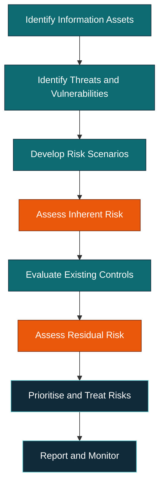

<div align="center">

# 🛡️ Solari Technologies Ltd.

### `Cybersecurity Risk Assessment Methodology`

**Phase 03 · Enterprise Cybersecurity Risk Assessment**


</div>

## 1. Purpose

This document defines a consistent approach for identifying, analysing, evaluating and treating cybersecurity risks affecting Solari Technologies Ltd.

The methodology supports risk-based decision-making, prioritisation, accountability and management reporting.

---

## 2. Scope

The methodology applies to the information assets, systems, business processes and third-party services identified in the Business Context and Scope Document.

Key areas include:

- 🖧 IT infrastructure and cloud services.
- 🪪 Identity and access management.
- 📂 Client information and managed IT services.
- 💻 Endpoint and network security.
- 💾 Backup and disaster recovery.
- 🤝 Third-party technology providers.

---

## 3. Reference Frameworks

| Framework | Application |
|---|---|
| **ISO 31000** | Risk management principles |
| **ISO/IEC 27005** | Information security risk management |
| **ISO/IEC 27001** | Information security governance and risk treatment |
| **NIST CSF 2.0** | Cybersecurity risk management |

---

## 4. Risk Assessment Process



### Risk Identification

Each risk will be described using:

```text
Threat  +  Vulnerability  +  Risk Event  +  Business Impact
```

**Example:**

> A phishing attack exploiting weak authentication controls could compromise an employee account, resulting in unauthorised access to confidential client information.

---

## 5. Likelihood Assessment

Likelihood represents the estimated probability of a risk event occurring within the next 12 months.

| Score | Rating | Description |
|:-:|---|---|
| **1** | Rare | Highly unlikely to occur |
| **2** | Unlikely | Possible but not expected |
| **3** | Possible | Could reasonably occur |
| **4** | Likely | Expected under several plausible conditions |
| **5** | Almost Certain | Expected frequently or imminently |

---

## 6. Impact Assessment

Impact represents the potential business consequences if a risk event occurs.

| Score | Rating | Description |
|:-:|---|---|
| **1** | Insignificant | Minimal disruption or loss |
| **2** | Minor | Limited and manageable impact |
| **3** | Moderate | Noticeable operational, financial or compliance impact |
| **4** | Major | Significant service disruption, financial loss or regulatory exposure |
| **5** | Severe | Widespread disruption, major data compromise or serious business consequences |

Impact assessment considers:

- Operational disruption.
- Financial loss.
- Confidentiality and privacy.
- Legal and regulatory consequences.
- Reputation and customer trust.
- Contractual and service delivery obligations.

> [!NOTE]
> The highest reasonably credible impact dimension determines the overall impact rating.

---

## 7. Risk Scoring and Colour Classification

```text
Risk Score = Likelihood × Impact
```

The assessment uses a 5 × 5 risk matrix, producing scores between 1 and 25.

### Standard Risk Rating

| Risk Score | Risk Level | Colour Code | Required Response |
|:-:|---|---|---|
| 1–4 | 🟢 **LOW** | `#16A34A` | Routine monitoring |
| 5–9 | 🟡 **MEDIUM** | `#EAB308` | Planned treatment |
| 10–16 | 🟠 **HIGH** | `#F97316` | Prioritised treatment |
| 17–25 | 🔴 **CRITICAL** | `#DC2626` | Urgent escalation and treatment |

> [!NOTE]
> These thresholds are proposed for this simulated assessment and are not formally approved organisational risk appetite.

### 5 × 5 Risk Matrix

| Likelihood ↓ / Impact → | 1 | 2 | 3 | 4 | 5 |
|---|:-:|:-:|:-:|:-:|:-:|
| **5 – Almost Certain** | 🟡 5 | 🟠 10 | 🟠 15 | 🔴 20 | 🔴 25 |
| **4 – Likely** | 🟢 4 | 🟡 8 | 🟠 12 | 🟠 16 | 🔴 20 |
| **3 – Possible** | 🟢 3 | 🟡 6 | 🟡 9 | 🟠 12 | 🟠 15 |
| **2 – Unlikely** | 🟢 2 | 🟢 4 | 🟡 6 | 🟡 8 | 🟠 10 |
| **1 – Rare** | 🟢 1 | 🟢 2 | 🟢 3 | 🟢 4 | 🟡 5 |

**Legend:** 🟢 Low &nbsp;|&nbsp; 🟡 Medium &nbsp;|&nbsp; 🟠 High &nbsp;|&nbsp; 🔴 Critical

---

## 8. Inherent and Residual Risk

### Inherent Risk

The level of risk before considering existing security controls.

```text
Inherent Risk = Inherent Likelihood × Inherent Impact
```

### Residual Risk

The risk remaining after considering implemented controls and their effectiveness.

```text
Residual Risk = Residual Likelihood × Residual Impact
```

### Example Risk Assessment

**Scenario:** Employee account compromise through phishing.

| Assessment Factor | Inherent Risk | Residual Risk |
|---|:-:|:-:|
| **Likelihood** | 4 – Likely | 2 – Unlikely |
| **Impact** | 4 – Major | 4 – Major |
| **Risk Score** | 16 | 8 |
| **Risk Level** | 🟠 **HIGH** | 🟡 **MEDIUM** |

**Assumed Controls:** Multifactor authentication, phishing awareness training and conditional access policies.

> [!WARNING]
> The residual rating assumes these controls have been implemented and verified as effective. No such verification has been performed in this simulated project.

---

## 9. Risk Treatment Options

| Treatment | Description |
|---|---|
| 🛡️ **Mitigate** | Implement controls to reduce likelihood or impact |
| 🚫 **Avoid** | Discontinue the activity creating the risk |
| 🔁 **Transfer / Share** | Allocate certain consequences through insurance or contracts |
| ✍️ **Accept** | Formally retain the risk with appropriate approval |

Risk treatment decisions must be documented and assigned to an authorised risk owner.

---

## 10. Risk Ownership and Escalation

| Name | Role | Responsibility |
|---|---|---|
| **Simon Etim** | **GRC Analyst & Assessment Lead** | **Coordinate assessments, maintain the risk register and report findings** |
| Chinedu Okafor | CISO | Review significant risks and escalate to management |
| Tunde Adebayo | IT Operations Manager | Support technical risk treatment |
| Amaka Nwosu | Cybersecurity Team Lead | Evaluate security controls and remediation |
| Funke Oladipo | Compliance Officer | Review compliance implications |
| Adewale Martins | CEO | Provide executive oversight for major risk decisions |

*Management names and positions are fictional.*

### Escalation Guidelines

| Risk Level | Escalation Requirement |
|---|---|
| 🔴 **Critical** | Immediate notification to CISO and relevant risk owner |
| 🟠 **High** | Prioritised management review and treatment planning |
| 🟡 **Medium** | Scheduled treatment or documented acceptance |
| 🟢 **Low** | Routine monitoring |

> [!NOTE]
> Specific escalation deadlines and risk acceptance authorities require formal approval before operational use.

---

## 11. Risk Register Requirements

Each risk entry must contain:

- Risk ID and description.
- Associated asset and business process.
- Threat and vulnerability.
- Potential business impact.
- Inherent likelihood, impact and rating.
- Existing controls and evidence status.
- Residual likelihood, impact and rating.
- Risk owner.
- Risk treatment action.
- Target completion date.
- Risk status and review date.

---

## 12. Risk Monitoring and Review

Risks will be reviewed:

- Quarterly as part of routine monitoring.
- Following significant security incidents.
- When major technology or business changes occur.
- When new threats or vulnerabilities emerge.
- After implementing significant risk treatments.

Critical risks may require more frequent monitoring.

---

## 13. Assumptions and Limitations

This methodology is developed for a simulated GRC portfolio project.

- Risk scores are based on hypothetical scenarios.
- No actual Solari systems have been assessed.
- Security control effectiveness has not been independently verified.
- Risk thresholds and escalation requirements are proposed.
- All management stakeholders are fictional.

---

## 14. Review and Approval

| Name | Role | Status |
|---|---|---|
| **Simon Etim** | **GRC Analyst / Assessment Lead** | **🟢 Draft Prepared** |
| Amaka Nwosu | Cybersecurity Team Lead | 🟡 Pending Review |
| Chinedu Okafor | Chief Information Security Officer | ⚪ Approval Not Obtained |

*Review and approval statuses are illustrative; no actual management approval is claimed.*

---

> Prepared by Simon Etim as an independent, simulated GRC portfolio exercise. All risk scenarios, scores, management stakeholders and approval activities are hypothetical and do not represent verified information about Solari Technologies Ltd.
