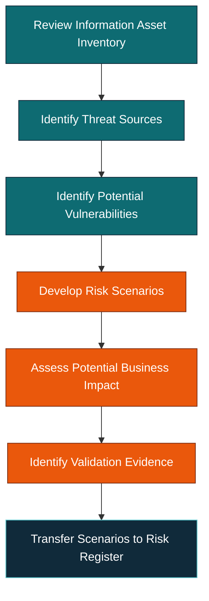
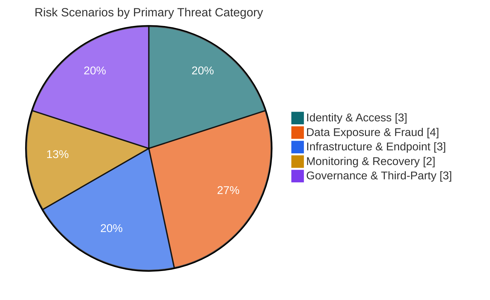

<div align="center">

# 🛡️ Solari Technologies Ltd.

### `Threat and Vulnerability Assessment`

**Phase 04 · Enterprise Cybersecurity Risk Assessment**


</div>

## 1. Executive Summary

This document identifies potential cybersecurity threats and vulnerabilities affecting the assumed information assets and IT services of Solari Technologies Ltd., a technology and IT consulting company based in Lagos, Nigeria, with 150 employees.

As the GRC Analyst and Assessment Lead, **Simon Etim** is responsible for coordinating threat identification, analysing potential exposure, developing risk scenarios and documenting findings for subsequent risk evaluation.

The assessment considers 15 information assets identified in the Information Asset Inventory (SOL-GRC-RA-002).

> [!NOTE]
> **Assessment basis:** All threats, vulnerabilities and risk scenarios are hypothetical. No live systems, client environments or security configurations have been examined.

---

## 2. Assessment Objectives

This assessment aims to:

1. Identify credible cybersecurity threats affecting business operations.
2. Identify potential vulnerabilities that could enable threat events.
3. Link threats and vulnerabilities to information assets.
4. Describe possible operational, financial, security and compliance consequences.
5. Establish documented risk scenarios for the cybersecurity risk register.
6. Identify evidence required to validate potential weaknesses.

---

## 3. Assessment Scope

The assessment covers the 15 assets documented in the simulated asset inventory.

| Asset Category | Assets Covered |
|---|---|
| 🪪 **Identity & Access Management** | `AST-002`, `AST-014` |
| ☁️ **Cloud & Collaboration** | `AST-001`, `AST-005` |
| 🛠️ **Managed Services & Client Information** | `AST-003`, `AST-004`, `AST-012` |
| 🖧 **Infrastructure & Endpoints** | `AST-006`, `AST-007` |
| 📡 **Security Operations & Recovery** | `AST-008`, `AST-009` |
| 📂 **Business & Governance Records** | `AST-010`, `AST-011`, `AST-013`, `AST-015` |

### 🚫 Exclusions

- Penetration testing or exploitation.
- Live vulnerability scanning.
- Unauthorised access to client systems.
- Physical security testing.
- Verification of actual Solari security configurations.

---

## 4. Threat Identification Approach

The assessment uses scenario-based threat modelling informed by ISO/IEC 27005, ISO 31000 and NIST CSF 2.0.

Potential threats are considered across four categories.

| Threat Category | Examples |
|---|---|
| 🌐 **External Cyber Threats** | Phishing, ransomware, credential attacks, exploitation |
| 👤 **Internal Threats** | Human error, misuse of privileges, accidental disclosure |
| ⚙️ **Technology Failures** | System outages, configuration errors, backup failures |
| 🤝 **Third-Party Threats** | Supplier compromise, service disruption, insecure integrations |

### Assessment Workflow



---

## 5. Threat and Vulnerability Register

The following scenarios are based on a hypothetical IT consulting and managed services environment.

> [!TIP]
> **How to read each table:** go left to right, like a sentence.
> **Which risk and asset** → **what could go wrong** → **why it could happen** → **what it would cause**.
> 🔴 marks the 5 priority scenarios (assets rated Critical). Asset names come from the Information Asset Inventory (SOL-GRC-RA-002).

### 5.1 🪪 Identity & Access Management

| Risk / Asset | What could go wrong<br>*(Threat)* | Why it could happen<br>*(Potential vulnerability)* | What it would cause<br>*(Possible business impact)* |
|---|---|---|---|
| 🔴 **`RSK-002`**<br>`AST-002`<br>Active Directory / Entra ID | 🔺 **Privilege Escalation** | Excessive permissions or weak privileged access controls | Unauthorised administrative access |
| 🔴 **`RSK-014`**<br>`AST-014`<br>Privileged Credentials & Secrets | 🔑 **Credential Theft** | Insecure secrets storage or credential reuse | Privileged system compromise |

### 5.2 ☁️ Cloud & Collaboration

| Risk / Asset | What could go wrong<br>*(Threat)* | Why it could happen<br>*(Potential vulnerability)* | What it would cause<br>*(Possible business impact)* |
|---|---|---|---|
| **`RSK-001`**<br>`AST-001`<br>Microsoft 365 Environment | 🎣 **Phishing / Account Takeover** | Weak authentication or inadequate phishing-resistant controls | Email compromise and unauthorised information disclosure |
| 🔴 **`RSK-005`**<br>`AST-005`<br>Cloud Infrastructure | ☁️ **Cloud Service Compromise** | Misconfigured access policies or exposed services | Data exposure and service disruption |

### 5.3 🛠️ Managed Services & Client Information

| Risk / Asset | What could go wrong<br>*(Threat)* | Why it could happen<br>*(Potential vulnerability)* | What it would cause<br>*(Possible business impact)* |
|---|---|---|---|
| **`RSK-003`**<br>`AST-003`<br>Client Project Documentation | 💧 **Data Leakage** | Inappropriate file-sharing permissions | Exposure of confidential client documentation |
| 🔴 **`RSK-004`**<br>`AST-004`<br>Remote Monitoring & Management Platform | 🛠️ **Remote Management Compromise** | Inadequate privileged access protection | Unauthorised administration of managed environments |
| **`RSK-012`**<br>`AST-012`<br>Client Support Ticketing System | 🎫 **Support System Compromise** | Weak authentication or excessive ticket access | Client information exposure and service disruption |

### 5.4 🖧 Infrastructure & Endpoints

| Risk / Asset | What could go wrong<br>*(Threat)* | Why it could happen<br>*(Potential vulnerability)* | What it would cause<br>*(Possible business impact)* |
|---|---|---|---|
| **`RSK-006`**<br>`AST-006`<br>Corporate Network Infrastructure | 🌐 **Network Intrusion** | Weak segmentation or insecure network configuration | Lateral movement and operational disruption |
| **`RSK-007`**<br>`AST-007`<br>Employee Laptops & Workstations | 🦠 **Malware / Ransomware** | Delayed patching or insufficient endpoint protection | Endpoint compromise and productivity loss |

### 5.5 📡 Security Operations & Recovery

| Risk / Asset | What could go wrong<br>*(Threat)* | Why it could happen<br>*(Potential vulnerability)* | What it would cause<br>*(Possible business impact)* |
|---|---|---|---|
| **`RSK-008`**<br>`AST-008`<br>Security Monitoring / SIEM Platform | 📡 **Security Monitoring Failure** | Incomplete logging or alert coverage | Delayed detection and incident response |
| 🔴 **`RSK-009`**<br>`AST-009`<br>Backup & Recovery Systems | 💾 **Backup Compromise** | Inadequate backup isolation or recovery testing | Extended outage and possible data loss |

### 5.6 📂 Business & Governance Records

| Risk / Asset | What could go wrong<br>*(Threat)* | Why it could happen<br>*(Potential vulnerability)* | What it would cause<br>*(Possible business impact)* |
|---|---|---|---|
| **`RSK-010`**<br>`AST-010`<br>Employee & Payroll Records | 👥 **Employee Data Breach** | Excessive access or insecure data handling | Privacy harm and potential regulatory exposure |
| **`RSK-011`**<br>`AST-011`<br>Financial & Billing Records | 💰 **Financial Fraud** | Weak payment verification or segregation of duties | Financial loss and inaccurate records |
| **`RSK-013`**<br>`AST-013`<br>Security Policies & Procedures | 📜 **Policy Governance Failure** | Outdated or poorly communicated policies | Inconsistent security practices |
| **`RSK-015`**<br>`AST-015`<br>Vendor Contracts & Service Agreements | 🤝 **Third-Party Security Failure** | Inadequate vendor due diligence | Contractual, operational or data protection exposure |

> [!WARNING]
> These are potential vulnerabilities, not confirmed findings.

---

## 6. Priority Threat Scenarios

Five scenarios warrant particular attention because they involve assets previously classified as Critical.

### 🔴 RSK-002 — Identity Infrastructure Compromise

| Field | Detail |
|---|---|
| **Asset** | `AST-002` — Active Directory / Microsoft Entra ID |
| **Threat** | Privilege escalation or unauthorised administrative access |
| **Potential Vulnerability** | Excessive privileges, weak authentication or inadequate account monitoring |
| **Risk Scenario** | An attacker compromises a privileged identity and gains unauthorised access to identity management services, potentially affecting multiple business systems. |
| **Potential Impact** | Loss of access control, disruption to authentication services and compromise of sensitive information. |
| **Evidence Required** | Privileged account inventory, MFA configuration, access review records and authentication logs. |

### 🔴 RSK-004 — Remote Management Platform Compromise

| Field | Detail |
|---|---|
| **Asset** | `AST-004` — Remote Monitoring & Management Platform |
| **Threat** | Unauthorised remote administration |
| **Potential Vulnerability** | Weak privileged access controls or inadequate administrative session monitoring |
| **Risk Scenario** | A threat actor compromises a remote management account and uses the platform to access managed endpoints. |
| **Potential Impact** | Client service disruption, unauthorised system changes and possible compromise of customer environments. |
| **Evidence Required** | Administrative access records, MFA configuration, session logs and remote access policies. |

### 🔴 RSK-005 — Cloud Infrastructure Compromise

| Field | Detail |
|---|---|
| **Asset** | `AST-005` — Cloud Infrastructure |
| **Threat** | Cloud account compromise or exploitation of exposed services |
| **Potential Vulnerability** | Misconfigured access policies, insecure network exposure or inadequate configuration monitoring |
| **Risk Scenario** | An attacker exploits a cloud configuration weakness to access sensitive workloads or disrupt hosted services. |
| **Potential Impact** | Data exposure, operational downtime and contractual consequences. |
| **Evidence Required** | Cloud configuration reports, access policies, logging settings and security posture assessments. |

### 🔴 RSK-009 — Backup and Recovery Failure

| Field | Detail |
|---|---|
| **Asset** | `AST-009` — Backup & Recovery Systems |
| **Threat** | Ransomware, backup tampering or infrastructure failure |
| **Potential Vulnerability** | Insufficient backup isolation or untested recovery procedures |
| **Risk Scenario** | A ransomware incident affects production systems and accessible backup copies, preventing timely restoration. |
| **Potential Impact** | Extended downtime, data loss and disruption to business and client services. |
| **Evidence Required** | Backup policies, backup job reports, immutability settings and restoration test records. |

### 🔴 RSK-014 — Privileged Credential Compromise

| Field | Detail |
|---|---|
| **Asset** | `AST-014` — Privileged Credentials & Secrets |
| **Threat** | Credential theft or misuse |
| **Potential Vulnerability** | Insecure secrets storage, credential reuse or excessive secret access |
| **Risk Scenario** | An attacker obtains privileged credentials and uses them to access sensitive infrastructure. |
| **Potential Impact** | Unauthorised changes, data compromise and disruption of critical services. |
| **Evidence Required** | Secrets management procedures, privileged access records, credential rotation policies and access logs. |

---

## 7. Risk Identification Summary

| Threat Category | Number of Scenarios |
|---|---:|
| 🪪 Identity & Access Threats | 3 |
| 💧 Data Exposure & Fraud | 4 |
| 🖧 Infrastructure & Endpoint Threats | 3 |
| 📡 Security Monitoring & Recovery | 2 |
| 📜 Governance & Third-Party Threats | 3 |
| **Total** | **15** |



*This categorisation is for portfolio reporting. Each scenario has been assigned one primary threat category.*

---

## 8. Risk Rating Standard

The following scoring standard will be applied when these scenarios are evaluated in the Cybersecurity Risk Register.

```text
Risk Score = Likelihood × Impact
```

| Risk Score | Risk Level | Colour | Required Action |
|:-:|---|---|---|
| 1–4 | 🟢 **LOW** | `#16A34A` | Routine monitoring |
| 5–9 | 🟡 **MEDIUM** | `#EAB308` | Planned treatment |
| 10–16 | 🟠 **HIGH** | `#F97316` | Prioritised treatment |
| 17–25 | 🔴 **CRITICAL** | `#DC2626` | Urgent escalation and treatment |

> [!NOTE]
> No risk scores have been assigned in this document. Risk identification alone does not establish likelihood or impact.

---

## 9. Recommended Validation Activities

| Assessment Area | Proposed Validation Activity |
|---|---|
| 🪪 **Identity Security** | Review privileged accounts, MFA and access review records |
| ☁️ **Cloud Security** | Examine cloud configuration and access policies |
| 💻 **Endpoint Security** | Review patch compliance and endpoint protection coverage |
| 🌐 **Network Security** | Review network segmentation and firewall rules |
| 💾 **Backup & Recovery** | Examine backup reports and restoration test evidence |
| 📡 **Security Monitoring** | Review log sources, alert coverage and response procedures |
| 🤝 **Third-Party Risk** | Examine vendor assessments and contractual security requirements |
| 🗂️ **Information Governance** | Review data classification, retention and access controls |

*These activities are recommendations only and have not been performed.*

---

## 10. Assessment Responsibilities

| Stakeholder | Responsibility |
|---|---|
| **Simon Etim – GRC Analyst & Assessment Lead** | **Coordinate threat identification, document risk scenarios and maintain assessment records** |
| Chinedu Okafor – CISO | Review assessment approach and significant exposures |
| Tunde Adebayo – IT Operations Manager | Provide infrastructure and configuration information |
| Amaka Nwosu – Cybersecurity Team Lead | Support threat analysis and security control review |
| Emeka Obi – Managed Services Manager | Assess managed service and client-related risks |
| Funke Oladipo – Compliance Officer | Review regulatory and contractual implications |

*All management stakeholders are fictional.*

---

## 11. Key Observations

Based on the simulated business environment:

1. Identity and privileged access are important security dependencies.
2. Remote management capabilities may create significant exposure if compromised.
3. Cloud configuration and access governance require particular attention.
4. Backup resilience is essential for business continuity.
5. Client information handling and supplier dependencies warrant structured oversight.

> [!NOTE]
> These are scenario-based observations, not verified organisational weaknesses.

---

## 12. Assumptions and Limitations

- All 15 threat scenarios are hypothetical.
- Potential vulnerabilities have not been technically validated.
- No interviews, system inspections or penetration tests were conducted.
- Actual security controls and their effectiveness remain unknown.
- Risk likelihood, impact and residual exposure will be assessed separately.
- No conclusions about actual Solari security posture should be drawn from this document.

---

## 13. Review and Approval

| Name | Role | Status |
|---|---|---|
| **Simon Etim** | **GRC Analyst / Assessment Lead** | **🟢 Draft Prepared** |
| Tunde Adebayo | IT Operations Manager | 🟡 Pending Review |
| Amaka Nwosu | Cybersecurity Team Lead | 🟡 Pending Review |
| Chinedu Okafor | Chief Information Security Officer | ⚪ Approval Not Obtained |

*Review and approval statuses are illustrative; no actual management approval is claimed.*

---

## 14. Document Control

| Version | Date | Description |
|---|---|---|
| 1.0 | 22 November 2026 | Initial simulated threat and vulnerability assessment |
