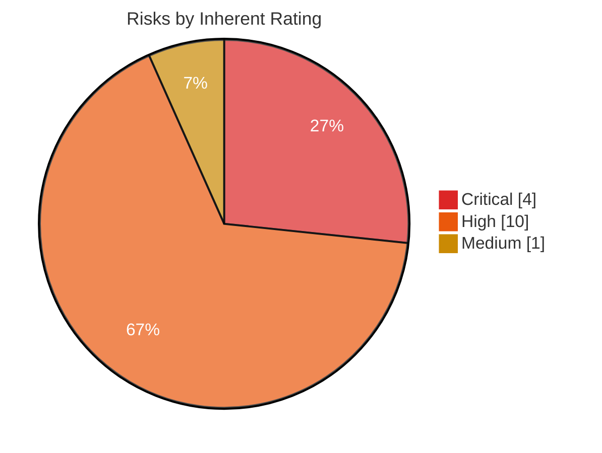

<div align="center">

# 🛡️ Solari Technologies Ltd.

### `Cybersecurity Risk Heat Map & Analysis`

**Phase 06 · Enterprise Cybersecurity Risk Assessment**


**Jump to:** [📊 Summary](#1-executive-summary) · [🔥 Heat Map](#3-enterprise-cybersecurity-risk-heat-map) · [🔎 Observations](#4-risk-distribution-and-prioritisation) · [🚨 Priority Risks](#5-priority-risk-analysis) · [👤 Owners](#6-risk-ownership-and-accountability) · [✅ Recommendations](#7-management-recommendations)

</div>

## 1. Executive Summary

This document presents an analysis of 15 simulated cybersecurity risks associated with the information assets and business operations of Solari Technologies Ltd., a technology and IT consulting company based in Lagos, Nigeria, with approximately 150 employees.

The analysis was prepared by **Simon Etim, GRC Analyst and Assessment Lead**, using the risk scoring methodology established in SOL-GRC-RA-003 and the inherent risk ratings documented in SOL-GRC-RA-005.

The purpose of this assessment is to visualise cybersecurity risk exposure, identify risk concentrations and support management prioritisation and risk treatment planning.

### 📊 Assessment Summary

| Risk Assessment Metric | Result | At a glance |
|---|:-:|---|
| Total Risks Assessed | **15** | |
| 🔴 Critical Risks | **4** | ▓▓▓▓▓▓░░░░░░░░░░ |
| 🟠 High Risks | **10** | ▓▓▓▓▓▓▓▓▓▓▓▓▓▓░░ |
| 🟡 Medium Risks | **1** | ▓░░░░░░░░░░░░░░ |
| 🟢 Low Risks | **0** | ░░░░░░░░░░░░░░░ |
| Average Inherent Risk Score | **14.67 / 25** | ▓▓▓▓▓▓░░░░ |
| Highest Inherent Risk Score | **20 / 25** | ▓▓▓▓▓▓▓▓░░ |
| High and Critical Risks | **93.3%** | ▓▓▓▓▓▓▓▓▓░ |

> [!NOTE]
> **Assessment limitation:** The risk scores are scenario-based estimates. No actual security vulnerabilities or control effectiveness have been verified.

---

## 2. Risk Assessment Methodology

Risks are evaluated using a 5 × 5 likelihood and impact matrix. Both likelihood and impact are rated from 1 to 5.

```text
Risk Score = Likelihood × Impact        Example: 4 × 5 = 20
```

### Standard Risk Classification

| Score | Risk Level | Colour Code | Response |
|:-:|---|---|---|
| 1–4 | 🟢 **LOW** | `#16A34A` | Routine monitoring |
| 5–9 | 🟡 **MEDIUM** | `#EAB308` | Planned treatment |
| 10–16 | 🟠 **HIGH** | `#F97316` | Prioritised treatment |
| 17–25 | 🔴 **CRITICAL** | `#DC2626` | Urgent escalation and treatment |

> [!NOTE]
> These thresholds are proposed for the portfolio simulation and are not formally approved organisational risk appetite.

---

## 3. Enterprise Cybersecurity Risk Heat Map

The matrix presents the inherent risk distribution based on the likelihood and impact scores recorded in the Cybersecurity Risk Register. Likelihood runs down the left side and Impact runs across the top.

**Risk IDs are abbreviated:** `001` represents `RSK-001`.

| Likelihood ↓ / Impact → | **1** Insignificant | **2** Minor | **3** Moderate | **4** Major | **5** Severe |
|---|:-:|:-:|:-:|:-:|:-:|
| **5** – Almost Certain | 🟡 | 🟠 | 🟠 | 🔴 | 🔴 |
| **4** – Likely | 🟢 | 🟡 | 🟠 | 🟠 **16**<br>`001` `007` | 🔴 **20**<br>`002` `004`<br>`005` `014` |
| **3** – Possible | 🟢 | 🟡 | 🟡 **9**<br>`013` | 🟠 **12**<br>`003` `006` `008`<br>`010` `011` `012`<br>`015` | 🟠 **15**<br>`009` |
| **2** – Unlikely | 🟢 | 🟢 | 🟡 | 🟡 | 🟠 |
| **1** – Rare | 🟢 | 🟢 | 🟢 | 🟢 | 🟡 |

**Legend:** 🟢 Low &nbsp;|&nbsp; 🟡 Medium &nbsp;|&nbsp; 🟠 High &nbsp;|&nbsp; 🔴 Critical &nbsp;·&nbsp; Cells without Risk IDs are empty.

### Risk Concentration by Matrix Position

| Likelihood (L) | Impact (I) | L × I | Number of Risks | Risk Level |
|---|---|:-:|:-:|:-:|
| 4 – Likely | 5 – Severe | **20** | 4 | 🔴 CRITICAL |
| 4 – Likely | 4 – Major | **16** | 2 | 🟠 HIGH |
| 3 – Possible | 5 – Severe | **15** | 1 | 🟠 HIGH |
| 3 – Possible | 4 – Major | **12** | 7 | 🟠 HIGH |
| 3 – Possible | 3 – Moderate | **9** | 1 | 🟡 MEDIUM |
| **TOTAL** | | | **15** | |

### 🔍 Explore the risks by level

*Click a level to expand the risks behind it.*

<details>
<summary><b>🔴 Critical (4)</b> &nbsp;·&nbsp; score 20</summary>

<br>

| Risk | Description | L × I |
|---|---|:-:|
| `RSK-002` | Unauthorised privileged access to identity infrastructure | 4 × 5 = **20** |
| `RSK-004` | Compromise of remote management platform | 4 × 5 = **20** |
| `RSK-005` | Cloud infrastructure compromise or service disruption | 4 × 5 = **20** |
| `RSK-014` | Theft or misuse of privileged credentials | 4 × 5 = **20** |

</details>

<details>
<summary><b>🟠 High (10)</b> &nbsp;·&nbsp; scores 12 to 16</summary>

<br>

| Risk | Description | L × I |
|---|---|:-:|
| `RSK-001` | Phishing-related Microsoft 365 account compromise | 4 × 4 = **16** |
| `RSK-007` | Endpoint malware or ransomware infection | 4 × 4 = **16** |
| `RSK-009` | Backup compromise or recovery failure | 3 × 5 = **15** |
| `RSK-003` | Unauthorised disclosure of client project information | 3 × 4 = **12** |
| `RSK-006` | Network intrusion through insecure configuration | 3 × 4 = **12** |
| `RSK-008` | Delayed detection due to inadequate security monitoring | 3 × 4 = **12** |
| `RSK-010` | Unauthorised exposure of employee personal data | 3 × 4 = **12** |
| `RSK-011` | Financial fraud or unauthorised payment changes | 3 × 4 = **12** |
| `RSK-012` | Compromise of client support ticketing system | 3 × 4 = **12** |
| `RSK-015` | Third-party security or service failure | 3 × 4 = **12** |

</details>

<details>
<summary><b>🟡 Medium (1)</b> &nbsp;·&nbsp; score 9</summary>

<br>

| Risk | Description | L × I |
|---|---|:-:|
| `RSK-013` | Security policy governance failure | 3 × 3 = **9** |

</details>

<details>
<summary><b>🟢 Low (0)</b></summary>

<br>

No risks are rated Low.

</details>

---

## 4. Risk Distribution and Prioritisation

| Risk Rating | Number of Risks | Percentage |
|---|:-:|:-:|
| 🔴 **CRITICAL** | 4 | 26.7% |
| 🟠 **HIGH** | 10 | 66.7% |
| 🟡 **MEDIUM** | 1 | 6.7% |
| 🟢 **LOW** | 0 | 0% |
| **TOTAL** | **15** | **100%** |



### 🔎 Key Observations

> [!WARNING]
> **Observation 01 — Concentration of Elevated Risks**
>
> Fourteen of the fifteen simulated risks are classified as High or Critical, representing 93.3% of the assessed scenarios.

> [!IMPORTANT]
> **Observation 02 — Critical Security Dependencies**
>
> The four Critical risks involve identity infrastructure, remote management, cloud infrastructure and privileged credentials.

> [!NOTE]
> **Observation 03 — Significant Potential Business Impact**
>
> Fourteen risks have an impact rating of 4 or 5, indicating potentially significant consequences for business operations, information security or service delivery.

> [!TIP]
> **Observation 04 — Residual Risk Not Yet Established**
>
> Existing security controls have not been validated. Therefore, the heat map represents inherent risk exposure rather than verified residual risk.

---

## 5. Priority Risk Analysis

*Click a risk to expand or collapse its details.*

<details open>
<summary><b>🔴 RSK-002 — Identity Infrastructure Compromise</b> &nbsp;·&nbsp; CRITICAL (20/25) &nbsp;·&nbsp; Owner: Tunde Adebayo</summary>

<br>

| Field | Detail |
|---|---|
| **Inherent Risk** | 🔴 CRITICAL (20/25) |
| **Risk Owner** | Tunde Adebayo |
| **Scenario** | A threat actor exploits weak privileged access controls to gain unauthorised administrative access to Active Directory or Microsoft Entra ID. |
| **Potential Business Impact** | Compromise of identity services, unauthorised access to business systems and operational disruption. |

**Proposed Controls:**

- Phishing-resistant MFA for privileged access.
- Privileged access management.
- Least-privilege access.
- Periodic privileged account reviews.
- Centralised authentication monitoring.

</details>

<details>
<summary><b>🔴 RSK-004 — Remote Management Platform Compromise</b> &nbsp;·&nbsp; CRITICAL (20/25) &nbsp;·&nbsp; Owner: Emeka Obi</summary>

<br>

| Field | Detail |
|---|---|
| **Inherent Risk** | 🔴 CRITICAL (20/25) |
| **Risk Owner** | Emeka Obi |
| **Scenario** | Compromised administrative credentials allow unauthorised remote access to managed endpoints. |
| **Potential Business Impact** | Client service disruption, unauthorised system changes and contractual exposure. |

**Proposed Controls:**

- MFA for remote management access.
- Role-based access controls.
- Administrative session monitoring.
- Restriction of remote management access.
- Regular review of privileged accounts.

</details>

<details>
<summary><b>🔴 RSK-005 — Cloud Infrastructure Compromise</b> &nbsp;·&nbsp; CRITICAL (20/25) &nbsp;·&nbsp; Owner: Tunde Adebayo</summary>

<br>

| Field | Detail |
|---|---|
| **Inherent Risk** | 🔴 CRITICAL (20/25) |
| **Risk Owner** | Tunde Adebayo |
| **Scenario** | Misconfigured cloud access policies or exposed services allow unauthorised access to sensitive workloads. |
| **Potential Business Impact** | Data exposure, service downtime and business interruption. |

**Proposed Controls:**

- Cloud security posture management.
- Secure configuration baselines.
- Least-privilege cloud access.
- Centralised logging.
- Continuous configuration monitoring.

</details>

<details>
<summary><b>🔴 RSK-014 — Privileged Credential Compromise</b> &nbsp;·&nbsp; CRITICAL (20/25) &nbsp;·&nbsp; Owner: Amaka Nwosu</summary>

<br>

| Field | Detail |
|---|---|
| **Inherent Risk** | 🔴 CRITICAL (20/25) |
| **Risk Owner** | Amaka Nwosu |
| **Scenario** | Privileged credentials are stolen or exposed through insecure storage or credential reuse. |
| **Potential Business Impact** | Unauthorised system administration, data compromise and disruption of critical infrastructure. |

**Proposed Controls:**

- Centralised secrets management.
- Privileged access management.
- Credential rotation and revocation.
- MFA where supported.
- Monitoring of privileged account activity.

</details>

---

## 6. Risk Ownership and Accountability

| Proposed Risk Owner | Department | Number of Risks |
|---|---|:-:|
| **Tunde Adebayo** | IT Operations | 6 |
| **Emeka Obi** | Managed Services | 3 |
| **Amaka Nwosu** | Cybersecurity | 2 |
| **Funke Oladipo** | Compliance | 2 |
| **Ngozi Eze** | Human Resources | 1 |
| **Ibrahim Bello** | Finance | 1 |
| | **TOTAL** | **15** |

**Simon Etim – GRC Analyst & Assessment Lead** is responsible for coordinating the assessment, maintaining risk documentation, analysing risk trends and preparing management reports.

Risk treatment accountability remains with the proposed business and technical risk owners.

*All ownership assignments are hypothetical and have not been formally accepted.*

---

## 7. Management Recommendations

| Risk Area | Recommended Action | Priority |
|---|---|:-:|
| 🪪 **Identity Infrastructure** | Strengthen privileged access and authentication controls | 🔴 CRITICAL |
| 🛠️ **Remote Management** | Secure administrative access and monitor remote sessions | 🔴 CRITICAL |
| ☁️ **Cloud Infrastructure** | Improve cloud configuration security and access governance | 🔴 CRITICAL |
| 🔑 **Privileged Credentials** | Implement secure credential and secrets management | 🔴 CRITICAL |
| 💻 **Endpoint Security** | Improve patching and endpoint protection | 🟠 HIGH |
| 🌐 **Network Security** | Strengthen network segmentation and configuration management | 🟠 HIGH |
| 💾 **Backup & Recovery** | Protect backup systems and test recovery procedures | 🟠 HIGH |
| 📂 **Client Information** | Strengthen access restrictions and information handling | 🟠 HIGH |
| 📜 **Security Governance** | Review and update security policies | 🟡 MEDIUM |

*All actions are recommendations. No remediation implementation is claimed.*

---

## 8. Existing Controls and Residual Risk

The effectiveness of existing security controls has not been established. Therefore:

| Item | Current Status |
|---|---|
| **Inherent risk** | ✅ Estimated for all 15 scenarios |
| **Existing controls** | ⚪ Not verified |
| **Residual likelihood** | ⚪ Not assessed |
| **Residual impact** | ⚪ Not assessed |
| **Residual risk rating** | 🟡 Pending control validation |

> [!WARNING]
> Residual risk ratings will be established only when sufficient evidence supports the effectiveness of relevant controls.

---

## 9. Risk Monitoring and Reporting

The GRC Analyst will maintain the simulated risk reporting process, focusing on:

- Risk distribution by severity.
- Critical and High risks requiring management attention.
- Risk ownership and treatment accountability.
- Progress of proposed remediation activities.
- Changes in likelihood and impact.
- Residual risk following control validation.

### Proposed Review Frequency

| Risk Level | Review Approach |
|---|---|
| 🔴 **Critical** | Frequent management oversight |
| 🟠 **High** | Prioritised management review |
| 🟡 **Medium** | Scheduled review |
| 🟢 **Low** | Routine monitoring |

> [!NOTE]
> Specific review frequencies and escalation deadlines require formal approval before operational use.

---

## 10. Assumptions and Limitations

This assessment is a simulated portfolio deliverable.

- No actual cybersecurity vulnerabilities were verified.
- No live security testing or stakeholder interviews were conducted.
- Likelihood and impact scores are illustrative.
- Risk ownership assignments are hypothetical.
- Existing control effectiveness remains unknown.
- Residual risk ratings have not been established.
- All management stakeholders are fictional.

---

## 11. Review and Approval

| Name | Role | Status |
|---|---|---|
| **Simon Etim** | **GRC Analyst & Assessment Lead** | **🟢 Draft Prepared** |
| Tunde Adebayo | IT Operations Manager | 🟡 Pending Review |
| Amaka Nwosu | Cybersecurity Team Lead | 🟡 Pending Review |
| Chinedu Okafor | Chief Information Security Officer | ⚪ Approval Not Obtained |

---

## 12. Document Control

| Version | Date | Description |
|---|---|---|
| 1.0 | 22 November 2026 | Initial simulated risk heat map and analysis based on the cybersecurity risk register |

### 📎 Supporting Documents

| Document | File |
|---|---|
| SOL-GRC-RA-002 — Information Asset Inventory & Classification | [SOL-GRC-RA-002-Information-Asset-Inventory.md](SOL-GRC-RA-002-Information-Asset-Inventory.md) |
| SOL-GRC-RA-003 — Cybersecurity Risk Assessment Methodology | [SOL-GRC-RA-003-Risk-Assessment-Methodology.md](SOL-GRC-RA-003-Risk-Assessment-Methodology.md) |
| SOL-GRC-RA-004 — Threat and Vulnerability Assessment | [SOL-GRC-RA-004-Threat-and-Vulnerability-Assessment.md](SOL-GRC-RA-004-Threat-and-Vulnerability-Assessment.md) |
| SOL-GRC-RA-005 — Enterprise Cybersecurity Risk Register | [SOL-GRC-RA-005-Cybersecurity-Risk-Register.md](SOL-GRC-RA-005-Cybersecurity-Risk-Register.md) |
| Supporting Risk Assessment Workbook | [SOL-GRC-RA-Risk-Assessment-Workbook.xlsx](SOL-GRC-RA-Risk-Assessment-Workbook.xlsx) |

---

> [!IMPORTANT]
> Risk scores are **scenario-based estimates** of *inherent* risk. No actual security vulnerabilities or control effectiveness have been verified. See the [Portfolio Disclaimer](#-portfolio-disclaimer).

[⬆️ Back to top](#️-solari-technologies-ltd)

</div>
