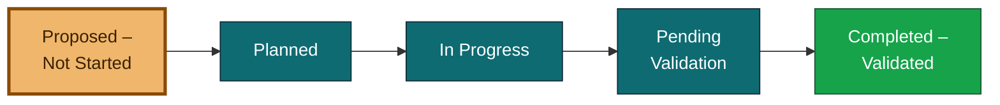
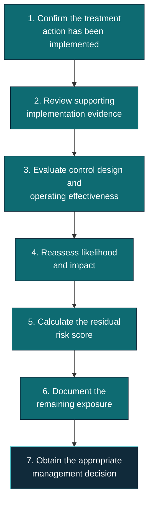

<a id="top"></a>

<div align="center">

# 🛡️ Solari Technologies Ltd.

### Enterprise Cybersecurity Risk Treatment Plan

**Phase 07 · Enterprise Cybersecurity Risk Assessment**


[Summary](#1-executive-summary) · [Treatment Register](#3-enterprise-cybersecurity-risk-treatment-register) · [Critical Risks](#5-priority-risk-treatment-analysis) · [Tracking](#7-treatment-implementation-and-tracking) · [Residual Risk](#8-residual-risk-assessment) · [Recommendations](#10-management-recommendations)

</div>

## 1. Executive Summary

This document presents the proposed cybersecurity risk treatment plan for Solari Technologies Ltd., a technology and IT consulting company based in Lagos, Nigeria, with approximately 150 employees.

The plan was prepared by **Simon Etim, GRC Analyst and Assessment Lead**, using the 15 simulated cybersecurity risks documented in the Enterprise Cybersecurity Risk Register (SOL-GRC-RA-005).

Its purpose is to translate identified cybersecurity risks into prioritised treatment actions, assign proposed accountability and establish requirements for implementation tracking and control validation.

### Treatment Summary

| Assessment Metric | Result | Distribution (15 risks) |
|---|:-:|:-:|
| Total Risks Requiring Treatment Review | **15** | `▓▓▓▓▓▓▓▓▓▓▓▓▓▓▓` |
| 🔴 Critical Priority | **4** | `▓▓▓▓░░░░░░░░░░░` |
| 🟠 High Priority | **10** | `▓▓▓▓▓▓▓▓▓▓░░░░░` |
| 🟡 Medium Priority | **1** | `▓░░░░░░░░░░░░░░` |
| 🟢 Low Priority | **0** | `░░░░░░░░░░░░░░░` |
| Treatment Actions Proposed | **15** | `▓▓▓▓▓▓▓▓▓▓▓▓▓▓▓` |
| Treatment Actions Completed | **0 confirmed** | `░░░░░░░░░░░░░░░` |
| Residual Risks Validated | **0** | `░░░░░░░░░░░░░░░` |

*Each block in the distribution column represents one of the 15 risks.*

> [!NOTE]
> **Assessment limitation:** All treatment activities remain proposed. No implementation, control validation or management approval is claimed.

---

## 2. Risk Treatment Methodology

Risk treatment follows the principles of ISO 31000 and ISO/IEC 27005, with consideration of ISO/IEC 27001 information security controls and NIST CSF 2.0.

Four treatment options are considered:

| Treatment Option | Description | Position in This Plan |
|---|---|:-:|
| **Mitigate** | Implement safeguards to reduce likelihood or impact | Proposed for all 15 |
| **Avoid** | Discontinue or modify the activity creating the risk | Not proposed |
| **Transfer / Share** | Allocate certain financial or operational consequences through contractual or insurance arrangements | Not proposed |
| **Accept** | Formally retain a risk within approved risk acceptance authority | Not proposed |

> [!TIP]
> **Selected approach:** Mitigation is recommended for all 15 simulated scenarios. This is a proposed strategy, not an approved treatment decision.

### Standard Risk Classification

| Score | Risk Level | Colour Code | Treatment Response |
|:-:|:-:|:-:|---|
| 1–4 | 🟢 **Low** | `#16A34A` | Routine monitoring |
| 5–9 | 🟡 **Medium** | `#EAB308` | Planned treatment |
| 10–16 | 🟠 **High** | `#F97316` | Prioritised treatment |
| 17–25 | 🔴 **Critical** | `#DC2626` | Urgent escalation and treatment |

```text
Risk Score = Likelihood × Impact
```

Risk ratings and thresholds are consistent with the approved-for-use *simulation methodology* in SOL-GRC-RA-003. They have not been formally approved by an actual organisation.

---

## 3. Enterprise Cybersecurity Risk Treatment Register

The following treatment entries reflect the uploaded risk assessment workbook. Entries are ordered by priority, then by inherent score.

**Status of all 15 actions:** Proposed – Not Started. Target completion dates have not been assigned.

| Risk ID | Asset | Inherent Risk (L × I) | Priority | Proposed Treatment | Proposed Owner |
|---|---|:-:|:-:|---|---|
| `RSK-002` | Active Directory / Entra ID | **20** (4 × 5) | 🔴 Critical | Implement privileged access safeguards | Tunde Adebayo |
| `RSK-004` | Remote Monitoring & Management Platform | **20** (4 × 5) | 🔴 Critical | Secure remote management access | Emeka Obi |
| `RSK-005` | Cloud Infrastructure | **20** (4 × 5) | 🔴 Critical | Strengthen cloud security configurations | Tunde Adebayo |
| `RSK-014` | Privileged Credentials & Secrets | **20** (4 × 5) | 🔴 Critical | Implement secure privileged credential management | Amaka Nwosu |
| `RSK-001` | Microsoft 365 Environment | **16** (4 × 4) | 🟠 High | Strengthen authentication and phishing protection | Tunde Adebayo |
| `RSK-007` | Employee Laptops & Workstations | **16** (4 × 4) | 🟠 High | Improve patching and endpoint protection | Tunde Adebayo |
| `RSK-009` | Backup & Recovery Systems | **15** (3 × 5) | 🟠 High | Protect backups and test restoration procedures | Tunde Adebayo |
| `RSK-003` | Client Project Documentation | **12** (3 × 4) | 🟠 High | Restrict and monitor client document access | Emeka Obi |
| `RSK-006` | Corporate Network Infrastructure | **12** (3 × 4) | 🟠 High | Improve segmentation and network configuration management | Tunde Adebayo |
| `RSK-008` | Security Monitoring / SIEM Platform | **12** (3 × 4) | 🟠 High | Improve security logging and alert coverage | Amaka Nwosu |
| `RSK-010` | Employee & Payroll Records | **12** (3 × 4) | 🟠 High | Strengthen employee data access controls | Ngozi Eze |
| `RSK-011` | Financial & Billing Records | **12** (3 × 4) | 🟠 High | Strengthen payment verification and approval controls | Ibrahim Bello |
| `RSK-012` | Client Support Ticketing System | **12** (3 × 4) | 🟠 High | Secure support platform authentication and permissions | Emeka Obi |
| `RSK-015` | Vendor Contracts & Service Agreements | **12** (3 × 4) | 🟠 High | Strengthen vendor due diligence and security oversight | Funke Oladipo |
| `RSK-013` | Security Policies & Procedures | **9** (3 × 3) | 🟡 Medium | Review and update security policies | Funke Oladipo |

---

## 4. Risk Ownership and Accountability

| Proposed Risk Owner | Department | Risks Owned | Count |
|---|---|---|:-:|
| **Tunde Adebayo** | IT Operations | `RSK-001` `RSK-002` `RSK-005` `RSK-006` `RSK-007` `RSK-009` | 6 |
| **Emeka Obi** | Managed Services | `RSK-003` `RSK-004` `RSK-012` | 3 |
| **Amaka Nwosu** | Cybersecurity | `RSK-008` `RSK-014` | 2 |
| **Funke Oladipo** | Compliance | `RSK-013` `RSK-015` | 2 |
| **Ngozi Eze** | Human Resources | `RSK-010` | 1 |
| **Ibrahim Bello** | Finance | `RSK-011` | 1 |
| **Total** | | | **15** |

**Simon Etim – GRC Analyst & Assessment Lead** is responsible for coordinating the proposed treatment planning process, maintaining documentation, monitoring progress and reporting significant risks.

Business and technical risk owners remain accountable for treatment decisions and assigned remediation activities, subject to actual approval.

---

## 5. Priority Risk Treatment Analysis

*Select a risk to expand or collapse its treatment details.*

<details open>
<summary><b>RSK-002 — Identity Infrastructure Compromise</b> · 🔴 Critical (20/25)</summary>

<br>

| Field | Detail |
|---|---|
| **Inherent Risk** | 🔴 Critical (20/25) |
| **Risk Owner** | Tunde Adebayo |
| **Treatment Strategy** | Mitigate |
| **Implementation Status** | Proposed – Not Started |
| **Scenario** | A threat actor exploits weak privileged access controls to gain unauthorised administrative access to Active Directory or Microsoft Entra ID. |
| **Potential Business Impact** | Unauthorised administrative access, identity service compromise and disruption to interconnected business systems. |
| **Expected Outcome** | Reduced opportunities for unauthorised privileged access. |

**Proposed Controls**

- Enforce phishing-resistant MFA for privileged accounts.
- Implement privileged access management.
- Apply least-privilege access principles.
- Conduct periodic privileged account reviews.
- Enable centralised authentication monitoring.

**Validation Evidence**

- MFA configuration reports.
- Privileged account inventory.
- Access review records.
- Authentication monitoring logs.

</details>

<details>
<summary><b>RSK-004 — Remote Management Platform Compromise</b> · 🔴 Critical (20/25)</summary>

<br>

| Field | Detail |
|---|---|
| **Inherent Risk** | 🔴 Critical (20/25) |
| **Risk Owner** | Emeka Obi |
| **Treatment Strategy** | Mitigate |
| **Implementation Status** | Proposed – Not Started |
| **Scenario** | Compromised administrative credentials enable unauthorised access to managed endpoints through the remote management platform. |
| **Potential Business Impact** | Client service disruption, unauthorised system changes and contractual exposure. |
| **Expected Outcome** | Stronger protection of remote administration capabilities and client environments. |

**Proposed Controls**

- Enforce MFA for remote management access.
- Implement role-based access controls.
- Restrict remote administration to authorised personnel.
- Monitor privileged administrative sessions.
- Review administrative permissions regularly.

**Validation Evidence**

- Remote access configuration.
- Administrative account inventory.
- Session monitoring logs.
- Access review records.

</details>

<details>
<summary><b>RSK-005 — Cloud Infrastructure Compromise</b> · 🔴 Critical (20/25)</summary>

<br>

| Field | Detail |
|---|---|
| **Inherent Risk** | 🔴 Critical (20/25) |
| **Risk Owner** | Tunde Adebayo |
| **Treatment Strategy** | Mitigate |
| **Implementation Status** | Proposed – Not Started |
| **Scenario** | Misconfigured cloud access policies or exposed services enable unauthorised access to sensitive cloud workloads. |
| **Potential Business Impact** | Data exposure, service downtime and operational disruption. |
| **Expected Outcome** | Reduced exposure to cloud misconfiguration and unauthorised access. |

**Proposed Controls**

- Establish secure cloud configuration baselines.
- Apply least-privilege access.
- Conduct periodic cloud configuration reviews.
- Enable centralised logging.
- Implement continuous cloud security posture monitoring.

**Validation Evidence**

- Cloud configuration assessment reports.
- IAM policy reviews.
- Cloud security posture reports.
- Security monitoring records.

</details>

<details>
<summary><b>RSK-014 — Privileged Credential Compromise</b> · 🔴 Critical (20/25)</summary>

<br>

| Field | Detail |
|---|---|
| **Inherent Risk** | 🔴 Critical (20/25) |
| **Risk Owner** | Amaka Nwosu |
| **Treatment Strategy** | Mitigate |
| **Implementation Status** | Proposed – Not Started |
| **Scenario** | Privileged credentials are stolen or exposed through insecure storage or credential reuse. |
| **Potential Business Impact** | Unauthorised system administration, sensitive information compromise and disruption of critical services. |
| **Expected Outcome** | Reduced risk of privileged credential theft and misuse. |

**Proposed Controls**

- Implement centralised secrets management.
- Restrict privileged credential access.
- Establish credential rotation and revocation procedures.
- Enforce MFA where supported.
- Monitor privileged account activity.

**Validation Evidence**

- Secrets management configuration.
- Credential access policies.
- Rotation records.
- Privileged access logs.

</details>

---

## 6. High and Medium Priority Treatment Actions

| Risk ID | Priority | Recommended Control Improvement | Proposed Owner |
|---|:-:|---|---|
| `RSK-001` | 🟠 High | MFA, phishing-resistant authentication and user awareness | Tunde Adebayo |
| `RSK-003` | 🟠 High | File-sharing restrictions and periodic access reviews | Emeka Obi |
| `RSK-006` | 🟠 High | Network segmentation and firewall configuration reviews | Tunde Adebayo |
| `RSK-007` | 🟠 High | Endpoint protection and vulnerability patch management | Tunde Adebayo |
| `RSK-008` | 🟠 High | Centralised logging, SIEM coverage and alert monitoring | Amaka Nwosu |
| `RSK-009` | 🟠 High | Isolated backups and periodic restoration testing | Tunde Adebayo |
| `RSK-010` | 🟠 High | Role-based HR data access and secure information handling | Ngozi Eze |
| `RSK-011` | 🟠 High | Payment verification and segregation of duties | Ibrahim Bello |
| `RSK-012` | 🟠 High | Support system MFA and access restrictions | Emeka Obi |
| `RSK-015` | 🟠 High | Vendor security due diligence and periodic assessments | Funke Oladipo |
| `RSK-013` | 🟡 Medium | Policy reviews, approval processes and employee communication | Funke Oladipo |

> [!NOTE]
> These controls are recommendations for further assessment and implementation planning, not verified existing safeguards.

---

## 7. Treatment Implementation and Tracking

Each treatment action should be monitored using a structured implementation record.

| # | Tracking Field | Requirement |
|:-:|---|---|
| 1 | **Risk ID** | Unique identifier linked to the risk register |
| 2 | **Risk Owner** | Accountable business or technical owner |
| 3 | **Treatment Action** | Agreed control or remediation activity |
| 4 | **Priority** | Critical, High, Medium or Low |
| 5 | **Target Date** | Agreed completion deadline |
| 6 | **Implementation Status** | Current progress of treatment |
| 7 | **Evidence** | Documentation supporting implementation |
| 8 | **Validation Result** | Outcome of control effectiveness assessment |
| 9 | **Residual Risk** | Reassessed likelihood, impact and rating |
| 10 | **Approval** | Documented management decision |

### Treatment Status Lifecycle



*The highlighted step is the current position of all 15 actions. **Deferred** and **Cancelled** are exception outcomes that follow a documented or authorised decision.*

### Treatment Status Definitions

| Status | Meaning |
|---|---|
| **Proposed – Not Started** | Treatment recommended but not initiated |
| **Planned** | Treatment approved and scheduled |
| **In Progress** | Implementation underway |
| **Pending Validation** | Implementation reported complete; effectiveness not yet verified |
| **Completed – Validated** | Evidence reviewed and control effectiveness confirmed |
| **Deferred** | Treatment postponed with documented justification |
| **Cancelled** | Treatment discontinued following an authorised decision |

> [!WARNING]
> **Current workbook position:** All treatment actions remain Proposed – Not Started. No target dates or validation results have been recorded.

### Treatment Progress Tracker

**0 of 15 completed** `▱▱▱▱▱▱▱▱▱▱▱▱▱▱▱`

*Copy this checklist into a GitHub issue or project board to track progress. Tick a box only when evidence supports completion.*

- [ ] `RSK-002` Implement privileged access safeguards
- [ ] `RSK-004` Secure remote management access
- [ ] `RSK-005` Strengthen cloud security configurations
- [ ] `RSK-014` Implement secure privileged credential management
- [ ] `RSK-001` Strengthen authentication and phishing protection
- [ ] `RSK-007` Improve patching and endpoint protection
- [ ] `RSK-009` Protect backups and test restoration procedures
- [ ] `RSK-003` Restrict and monitor client document access
- [ ] `RSK-006` Improve segmentation and network configuration management
- [ ] `RSK-008` Improve security logging and alert coverage
- [ ] `RSK-010` Strengthen employee data access controls
- [ ] `RSK-011` Strengthen payment verification and approval controls
- [ ] `RSK-012` Secure support platform authentication and permissions
- [ ] `RSK-015` Strengthen vendor due diligence and security oversight
- [ ] `RSK-013` Review and update security policies

---

## 8. Residual Risk Assessment

Residual risk represents the exposure remaining after considering implemented and validated controls.

```text
Residual Risk = Residual Likelihood × Residual Impact
```

Residual risk should be assessed only after the relevant controls have been evaluated.

### Residual Risk Assessment Requirements



### Residual Risk Tracking

| Assessment Element | Current Status |
|---|---|
| **Inherent Risk Ratings** | ✅ Documented |
| **Treatment Recommendations** | ✅ Documented |
| **Implementation Evidence** | ⚪ Not Available |
| **Control Effectiveness** | ⚪ Not Verified |
| **Residual Risk Scores** | 🟡 Pending |
| **Management Acceptance** | ⚪ Not Obtained |

> [!IMPORTANT]
> Proposed controls do not automatically reduce residual risk. Any reduction must be supported by appropriate evidence and justified reassessment.

---

## 9. Risk Monitoring and Reporting

The GRC Analyst should maintain periodic reporting covering:

- Critical and High risks requiring management attention.
- Treatment actions awaiting approval.
- Implementation progress against agreed deadlines.
- Overdue or deferred remediation activities.
- Evidence of control implementation.
- Changes in inherent and residual risk.
- Risks requiring escalation or formal acceptance.

### Proposed Monitoring Approach

| Risk Level | Monitoring Requirement |
|:-:|---|
| 🔴 **Critical** | Frequent management oversight and escalation |
| 🟠 **High** | Prioritised remediation tracking |
| 🟡 **Medium** | Scheduled treatment review |
| 🟢 **Low** | Routine monitoring |

> [!NOTE]
> Specific reporting intervals and escalation deadlines require formal organisational approval.

---

## 10. Management Recommendations

Based on the simulated assessment, the following actions are recommended:

| # | Recommendation | Description |
|:-:|---|---|
| 1 | **Prioritise Critical Risks** | Focus initial treatment planning on identity infrastructure, remote management, cloud infrastructure and privileged credentials. |
| 2 | **Confirm Risk Ownership** | Obtain acknowledgement from proposed risk owners and clarify implementation responsibilities. |
| 3 | **Establish Treatment Deadlines** | Agree realistic milestones based on risk severity, operational dependencies and available resources. |
| 4 | **Validate Security Controls** | Require evidence of implementation and operating effectiveness before adjusting residual risk ratings. |
| 5 | **Monitor Treatment Progress** | Maintain a central treatment tracker and report unresolved significant risks to management. |

*These recommendations are illustrative and have not been approved or implemented.*

---

## 11. Assumptions and Limitations

This treatment plan is a simulated portfolio deliverable.

- All risk scenarios and ratings are hypothetical.
- No live remediation activities have been performed.
- Proposed risk owners have not accepted formal accountability.
- No treatment deadlines have been approved.
- Existing controls have not been independently verified.
- No residual risk reductions have been demonstrated.
- All management stakeholders are fictional.

---

## 12. Review and Approval

| Name | Role | Status |
|---|---|---|
| **Simon Etim** | **GRC Analyst & Assessment Lead** | **🟢 Draft Prepared** |
| Tunde Adebayo | IT Operations Manager | 🟡 Pending Review |
| Amaka Nwosu | Cybersecurity Team Lead | 🟡 Pending Review |
| Emeka Obi | Managed Services Manager | 🟡 Pending Review |
| Chinedu Okafor | Chief Information Security Officer | ⚪ Approval Not Obtained |

---

## 13. Document Control

| Version | Date | Description |
|:-:|---|---|
| 1.0 | 23 November 2026 | Initial simulated enterprise cybersecurity risk treatment plan aligned with the assessment workbook |

---
<div align="right">

</div>
