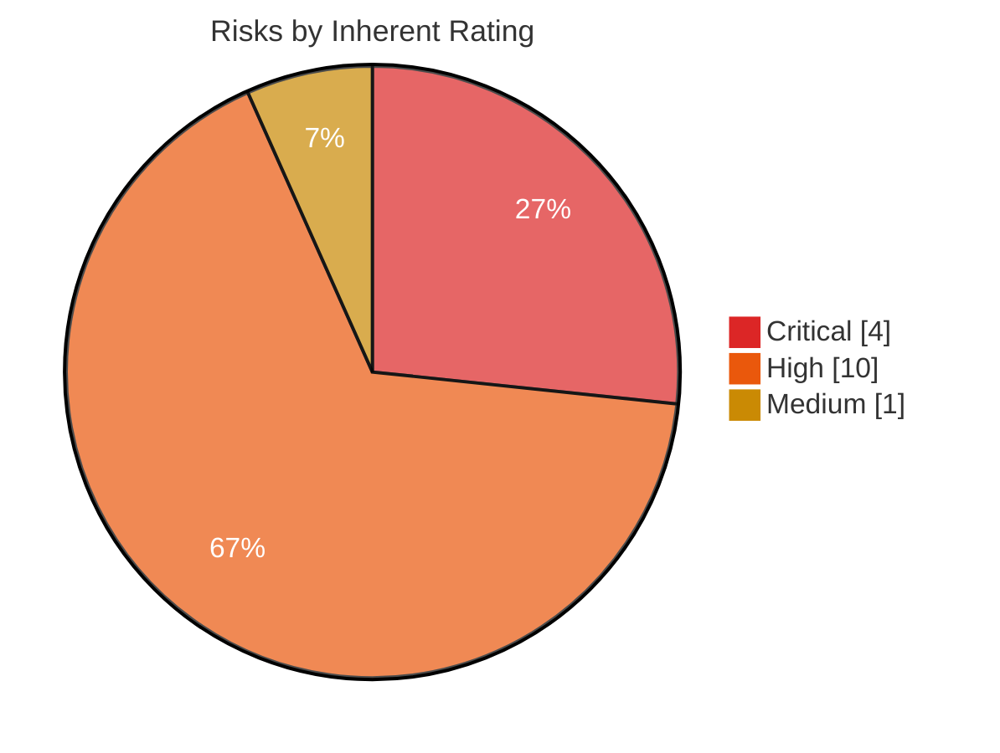
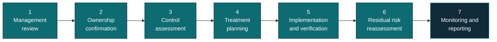

<a id="top"></a>

<div align="center">

# 🛡️ Solari Technologies Ltd.

### Executive Cybersecurity Risk Assessment Report

**Phase 08 · Enterprise Cybersecurity Risk Assessment**


[Results](#1-executive-summary) · [Risk Profile](#4-enterprise-cybersecurity-risk-profile) · [Critical Risks](#5-critical-cybersecurity-risks-requiring-executive-attention) · [Treatment](#7-proposed-risk-treatment-strategy) · [Decisions](#9-executive-decisions-requested) · [Conclusion](#12-overall-assessment-conclusion)

</div>

## 1. Executive Summary

This report presents the results of a simulated enterprise cybersecurity risk assessment conducted for Solari Technologies Ltd., a technology and IT consulting organisation operating in Lagos, Nigeria, with approximately 150 employees.

The assessment evaluates potential cybersecurity threats affecting the organisation's information assets, technology infrastructure, client services and business operations.

Prepared by **Simon Etim, GRC Analyst and Assessment Lead**, the report consolidates the assessment methodology, asset inventory, risk register, risk heat map and proposed risk treatment activities into a single executive-level overview.

### 1.1 Assessment Results

| Key Risk Indicator | Assessment Result |
|---|:-:|
| Information Assets Assessed | **15** |
| Cybersecurity Risks Identified | **15** |
| 🔴 Critical Risks | **4** |
| 🟠 High Risks | **10** |
| 🟡 Medium Risks | **1** |
| 🟢 Low Risks | **0** |
| Average Inherent Risk Score | **14.67 / 25** |
| Risks Rated High or Critical | **93.3%** |
| Verified Residual Risk Ratings | **0** |

### 1.2 Executive Assessment

The simulated assessment indicates a concentration of elevated inherent cybersecurity risks across several important business and technology functions.

Four risk scenarios received Critical inherent ratings, each scoring 20 out of 25:

| Risk ID | Scenario |
|---|---|
| `RSK-002` | Identity Infrastructure Compromise |
| `RSK-004` | Remote Management Platform Compromise |
| `RSK-005` | Cloud Infrastructure Compromise |
| `RSK-014` | Privileged Credential Compromise |

These scenarios could potentially affect the confidentiality, integrity and availability of business systems, sensitive information and client services.

> [!IMPORTANT]
> **Executive conclusion:** The modelled risk profile supports prioritising identity security, privileged access, remote administration and cloud security for control validation and treatment planning.

However, the assessment does not establish that these weaknesses actually exist or that existing controls are ineffective. Residual risk remains unknown pending evidence-based validation.

---

## 2. Business Context and Assessment Scope

### 2.1 Organisation Overview

| Business Attribute | Description |
|---|---|
| **Organisation** | Solari Technologies Ltd. |
| **Industry** | Technology and IT Consulting |
| **Location** | Lagos, Nigeria |
| **Workforce** | Approximately 150 employees |
| **Business Activities** | IT consulting, managed services, cloud solutions, cybersecurity consulting and infrastructure support |
| **Assessment Type** | Enterprise Cybersecurity Risk Assessment |
| **Assessment Lead** | Simon Etim |

### 2.2 Assessment Objectives

The assessment was designed to:

1. Identify information assets supporting critical business activities.
2. Evaluate potential cybersecurity threats and vulnerabilities.
3. Estimate inherent cybersecurity risk exposure.
4. Establish risk ownership and accountability.
5. Prioritise risks requiring management attention.
6. Recommend appropriate risk treatment measures.
7. Provide a foundation for continuous risk monitoring.

### 2.3 Assessment Coverage and Exclusions

| Covered by the assessment | Not performed |
|---|---|
| Identity and access management | Penetration testing or exploitation |
| Cloud infrastructure and hosted services | Live vulnerability scanning |
| Corporate networks and employee endpoints | Source code security reviews |
| Client information and managed service platforms | Physical security testing |
| Security monitoring and incident detection | Unauthorised client environment assessments |
| Backup and recovery capabilities | Independent financial audits |
| Employee and financial information | |
| Security governance and third-party dependencies | |

> [!NOTE]
> The assessment is a simulated, documentation-based exercise rather than a technical assurance engagement.

---

## 3. Risk Assessment Approach

The assessment methodology draws on recognised risk management and information security guidance.

| Framework | Application |
|---|---|
| **ISO 31000** | General risk management principles |
| **ISO/IEC 27005** | Information security risk assessment and treatment |
| **ISO/IEC 27001** | Information security management and control considerations |
| **NIST CSF 2.0** | Cybersecurity governance, protection, detection, response and recovery |
| **Nigeria Data Protection Act 2023** | Relevant data protection considerations, subject to applicability |

These references guide the simulated assessment. No certification or legal compliance determination is claimed.

### 3.1 Risk Scoring Method

```text
Risk Score = Likelihood × Impact
```

Likelihood and impact are assessed on a five-point scale.

### 3.2 Standard Risk Classification

| Score | Risk Level | Colour Code | Management Response |
|:-:|:-:|:-:|---|
| 1–4 | 🟢 **Low** | `#16A34A` | Routine monitoring |
| 5–9 | 🟡 **Medium** | `#EAB308` | Planned treatment |
| 10–16 | 🟠 **High** | `#F97316` | Prioritised treatment |
| 17–25 | 🔴 **Critical** | `#DC2626` | Urgent escalation and treatment |

> [!NOTE]
> These thresholds are defined for the simulation and do not represent formally approved organisational risk appetite.

---

## 4. Enterprise Cybersecurity Risk Profile

### 4.1 Inherent Risk Distribution

| Risk Level | Number of Risks | Percentage | Distribution (15 risks) |
|:-:|:-:|:-:|:-:|
| 🔴 **Critical** | 4 | 26.7% | `▓▓▓▓░░░░░░░░░░░` |
| 🟠 **High** | 10 | 66.7% | `▓▓▓▓▓▓▓▓▓▓░░░░░` |
| 🟡 **Medium** | 1 | 6.7% | `▓░░░░░░░░░░░░░░` |
| 🟢 **Low** | 0 | 0% | `░░░░░░░░░░░░░░░` |
| **Total** | **15** | **100%** | `▓▓▓▓▓▓▓▓▓▓▓▓▓▓▓` |

*Each block represents one of the 15 risks.*



> [!WARNING]
> **Key finding:** Fourteen of the fifteen assessed scenarios are classified as High or Critical before accounting for existing security controls.

### 4.2 Risk Heat Map Summary

Likelihood runs down the left side and Impact runs across the top. Each cell shows how many risks sit at that position.

| Likelihood ↓ / Impact → | **1** | **2** | **3** | **4** | **5** |
|---|:-:|:-:|:-:|:-:|:-:|
| **5** – Almost Certain | 🟡 | 🟠 | 🟠 | 🔴 | 🔴 |
| **4** – Likely | 🟢 | 🟡 | 🟠 | 🟠 **2 risks** | 🔴 **4 risks** |
| **3** – Possible | 🟢 | 🟡 | 🟡 **1 risk** | 🟠 **7 risks** | 🟠 **1 risk** |
| **2** – Unlikely | 🟢 | 🟢 | 🟡 | 🟡 | 🟠 |
| **1** – Rare | 🟢 | 🟢 | 🟢 | 🟢 | 🟡 |

🟢 Low &nbsp;·&nbsp; 🟡 Medium &nbsp;·&nbsp; 🟠 High &nbsp;·&nbsp; 🔴 Critical &nbsp;·&nbsp; Cells without a count contain no risks.

The heat map illustrates the concentration of risk scenarios with Major or Severe potential business impacts.

### 4.3 Interpretation

The assessment highlights three important observations.

> [!IMPORTANT]
> **Concentration of privileged access exposure:** Several significant risks involve administrative permissions, identity systems and credentials.

> [!WARNING]
> **Potential operational and client service disruption:** Cloud infrastructure, remote management and backup systems are important dependencies within the simulated business model.

> [!TIP]
> **Need for evidence-based assurance:** The assessment identifies potential exposures, but does not establish whether existing controls sufficiently mitigate them.

---

## 5. Critical Cybersecurity Risks Requiring Executive Attention

Four scenarios have been assigned the highest inherent risk rating.

| Risk ID | Critical Risk | Proposed Owner | Score |
|---|---|---|:-:|
| `RSK-002` | Identity Infrastructure Compromise | Tunde Adebayo | 🔴 **20** |
| `RSK-004` | Remote Management Platform Compromise | Emeka Obi | 🔴 **20** |
| `RSK-005` | Cloud Infrastructure Compromise | Tunde Adebayo | 🔴 **20** |
| `RSK-014` | Privileged Credential Compromise | Amaka Nwosu | 🔴 **20** |

*Select a risk to expand or collapse its details.*

<details open>
<summary><b>5.1 RSK-002 — Identity Infrastructure Compromise</b> · 🔴 Critical (20/25)</summary>

<br>

| Field | Detail |
|---|---|
| **Potential Risk** | Excessive administrative permissions or inadequate privileged access protection could enable unauthorised access to identity infrastructure. |
| **Business Consequences** | Compromise of authentication services, unauthorised system access and operational disruption. |
| **Recommended Management Action** | Prioritise assessment of privileged access management, phishing-resistant MFA, least-privilege enforcement and administrative account monitoring. |

</details>

<details>
<summary><b>5.2 RSK-004 — Remote Management Platform Compromise</b> · 🔴 Critical (20/25)</summary>

<br>

| Field | Detail |
|---|---|
| **Potential Risk** | Compromise of remote administration capabilities could enable unauthorised access to managed systems. |
| **Business Consequences** | Client service interruption, unauthorised system changes and contractual exposure. |
| **Recommended Management Action** | Review remote management authentication, administrative permissions, session monitoring and access restrictions. |

</details>

<details>
<summary><b>5.3 RSK-005 — Cloud Infrastructure Compromise</b> · 🔴 Critical (20/25)</summary>

<br>

| Field | Detail |
|---|---|
| **Potential Risk** | Insecure cloud configurations or access policies could expose business applications and sensitive workloads. |
| **Business Consequences** | Data exposure, service interruption and business continuity challenges. |
| **Recommended Management Action** | Prioritise cloud configuration assessments, access reviews, logging and security posture monitoring. |

</details>

<details>
<summary><b>5.4 RSK-014 — Privileged Credential Compromise</b> · 🔴 Critical (20/25)</summary>

<br>

| Field | Detail |
|---|---|
| **Potential Risk** | Insecure credential storage or reuse could expose privileged system access. |
| **Business Consequences** | Unauthorised system administration, sensitive information compromise and disruption of critical services. |
| **Recommended Management Action** | Assess secrets management, credential rotation, privileged access restrictions and monitoring. |

</details>

> [!TIP]
> **Executive observation:** These four scenarios share dependencies involving privileged access and administrative security. Coordinated control improvements may therefore address multiple risk scenarios.

---

## 6. Other Material Cybersecurity Risks

In addition to the four Critical scenarios, ten risks received High inherent ratings.

| Risk ID | Risk Area | Score | Potential Business Consequence |
|---|---|:-:|---|
| `RSK-001` | Microsoft 365 Account Compromise | 🟠 **16** | Email compromise and information disclosure |
| `RSK-007` | Endpoint Malware / Ransomware | 🟠 **16** | Endpoint compromise and productivity loss |
| `RSK-009` | Backup Compromise | 🟠 **15** | Extended outage and possible data loss |
| `RSK-003` | Client Information Exposure | 🟠 **12** | Disclosure of confidential client documents |
| `RSK-006` | Network Intrusion | 🟠 **12** | Lateral movement and operational disruption |
| `RSK-008` | Security Monitoring Failure | 🟠 **12** | Delayed threat detection and incident response |
| `RSK-010` | Employee Data Breach | 🟠 **12** | Privacy harm and potential regulatory exposure |
| `RSK-011` | Financial Fraud | 🟠 **12** | Financial loss and inaccurate records |
| `RSK-012` | Support System Compromise | 🟠 **12** | Client information exposure and service disruption |
| `RSK-015` | Third-Party Security Failure | 🟠 **12** | Contractual, operational or data protection exposure |

The remaining scenario, **RSK-013 — Security Policy Governance Failure**, is rated 🟡 Medium (9/25).

These risks should remain within the treatment planning process, with prioritisation informed by business dependencies and validated control effectiveness.

---

## 7. Proposed Risk Treatment Strategy

### 7.1 Treatment Direction

Mitigation is recommended as the initial treatment strategy for all 15 risk scenarios.

Final treatment decisions should consider control effectiveness, implementation feasibility, costs, operational requirements and formally approved risk acceptance criteria.

### 7.2 Executive Treatment Priorities

| Priority | Security Focus | Recommended Action | Responsible Function |
|:-:|---|---|---|
| 🔴 Critical | Identity & Privileged Access | Assess and strengthen administrative access safeguards | IT Operations |
| 🔴 Critical | Remote Management | Secure remote administration and session monitoring | Managed Services |
| 🔴 Critical | Cloud Security | Review cloud access policies and secure configurations | IT Operations |
| 🔴 Critical | Credential Security | Strengthen privileged credential and secrets management | Cybersecurity |
| 🟠 High | Endpoint & Network Security | Improve patching, endpoint protection and segmentation | IT Operations |
| 🟠 High | Security Monitoring | Review logging coverage and alert effectiveness | Cybersecurity |
| 🟠 High | Business Resilience | Validate backup protection and restoration capabilities | IT Operations |
| 🟠 High | Information Protection | Review employee, client and financial information controls | Relevant Business Owners |
| 🟡 Medium | Security Governance | Review policies and security responsibilities | Compliance |

*All recommendations are proposed. Implementation has not been confirmed.*

### 7.3 Implementation Status

| Treatment Indicator | Current Position |
|---|:-:|
| Proposed Treatment Actions | **15** |
| Treatment Actions Started | None confirmed |
| Treatment Actions Completed | None confirmed |
| Target Completion Dates | Not assigned |
| Control Effectiveness | Not verified |
| Residual Risk | Not assessed |

---

## 8. Risk Governance and Accountability

Effective cybersecurity risk management requires clearly defined responsibilities and appropriate executive oversight.

### 8.1 Proposed Governance Structure

| Role | Proposed Responsibility |
|---|---|
| **Chief Executive Officer** | Executive oversight and resource decisions |
| **Chief Information Security Officer** | Cybersecurity governance and risk escalation |
| **GRC Analyst & Assessment Lead** | Assessment coordination, risk documentation and reporting |
| **IT Operations Manager** | Infrastructure, identity and recovery-related risks |
| **Cybersecurity Team Lead** | Security monitoring, threat controls and privileged credential risks |
| **Managed Services Manager** | Client service and remote management risks |
| **Compliance Officer** | Security policy and third-party governance |
| **HR Head** | Employee information risks |
| **Finance Manager** | Financial and payment-related risks |

### 8.2 GRC Assessment Leadership

**Simon Etim — GRC Analyst & Assessment Lead**

Responsibilities within this simulated engagement include:

- Establishing and applying the risk assessment methodology.
- Coordinating information asset and risk identification.
- Evaluating inherent likelihood and impact.
- Maintaining the risk register and heat map.
- Documenting risk treatment recommendations.
- Preparing executive risk reports.
- Tracking control validation and residual risk assessment requirements.

> [!NOTE]
> All other named management stakeholders are fictional. Their responsibilities represent proposed governance arrangements rather than actual assignments.

---

## 9. Executive Decisions Requested

The following decisions are proposed for consideration by the fictional executive management team.

| Decision ID | Proposed Executive Decision | Accountable Role | Status |
|---|---|---|:-:|
| `DEC-001` | Review the four Critical inherent risk scenarios and their treatment priorities | CISO | ⚪ Pending |
| `DEC-002` | Confirm risk owners and implementation responsibilities | CISO / Functional Managers | ⚪ Pending |
| `DEC-003` | Authorise evidence gathering and security control validation | CISO | ⚪ Pending |
| `DEC-004` | Review proposed remediation resources and dependencies | CEO / CISO | ⚪ Pending |
| `DEC-005` | Establish treatment milestones and reporting requirements | CISO / Risk Owners | ⚪ Pending |
| `DEC-006` | Review and approve risk acceptance criteria and escalation thresholds | Executive Management | ⚪ Pending |

> [!WARNING]
> **Approval status:** No actual executive decisions or approvals have been obtained.

---

## 10. Proposed Risk Management Action Plan

The following roadmap illustrates a logical sequence for progressing from assessment to evidence-based risk treatment.



| Stage | Proposed Activity | Expected Deliverable |
|:-:|---|---|
| 1 | Management review of assessment findings | Documented review decisions |
| 2 | Risk ownership and accountability confirmation | Accepted risk assignments |
| 3 | Existing control and evidence assessment | Control validation results |
| 4 | Treatment planning and resource review | Approved remediation plan |
| 5 | Control implementation and verification | Implementation evidence |
| 6 | Residual risk reassessment | Updated risk register |
| 7 | Ongoing monitoring and executive reporting | Risk status and trend reports |

> [!NOTE]
> This roadmap does not represent activities already performed. Timelines and responsible parties require formal agreement before operational implementation.

---

## 11. Residual Risk and Assurance Requirements

Inherent risk represents exposure before considering the effectiveness of existing security controls.

Residual risk represents the exposure remaining after relevant controls have been assessed.

### 11.1 Current Assessment Position

| Assessment Component | Status |
|---|---|
| **Asset Identification** | ✅ Documented – Simulated |
| **Threat and Vulnerability Identification** | ✅ Documented – Simulated |
| **Inherent Risk Assessment** | ✅ Completed – Illustrative |
| **Risk Prioritisation** | ✅ Completed – Illustrative |
| **Proposed Treatment Planning** | ✅ Documented |
| **Existing Control Validation** | ⚪ Not Performed |
| **Residual Risk Assessment** | 🟡 Pending |
| **Formal Risk Acceptance** | ⚪ Not Obtained |

### 11.2 Required Assurance Activities

Before residual risk can be reported reliably, the following activities are recommended:

- Obtain evidence of existing security control design and implementation.
- Review access configurations and privileged account records.
- Examine cloud and endpoint security configurations.
- Evaluate logging, monitoring and incident response capabilities.
- Review backup protection and restoration test evidence.
- Document control testing outcomes and deficiencies.
- Reassess likelihood and impact using verified evidence.

> [!IMPORTANT]
> **Management consideration:** No reduction in risk scores should be reported solely because security controls have been proposed.

---

## 12. Overall Assessment Conclusion

The simulated enterprise cybersecurity risk assessment identifies 15 potential risk scenarios affecting Solari Technologies Ltd.'s information assets and business operations.

Four scenarios received Critical inherent ratings, ten were classified as High and one as Medium.

The assessment highlights privileged access, identity infrastructure, remote administration and cloud security as the principal areas requiring prioritised attention under the modelled assumptions.

From a governance perspective, the most important next step is to establish whether existing controls adequately address these potential exposures.

> [!IMPORTANT]
> **The recommended management approach is to prioritise control validation, confirm risk ownership, develop an approved treatment schedule and reassess residual risk based on documented evidence.**

This would provide a more reliable basis for risk acceptance, investment decisions and ongoing cybersecurity oversight.

---

## 13. Assessment Assumptions and Limitations

This report is an independent, simulated GRC portfolio deliverable.

- Solari Technologies Ltd. is a hypothetical organisation.
- All management stakeholders, except Simon Etim, are fictional.
- No real organisational systems were accessed or tested.
- No live stakeholder interviews were conducted.
- Risk scenarios and likelihood-impact scores are illustrative.
- Existing security control effectiveness has not been established.
- No treatment implementation or executive approval is claimed.
- Residual risk ratings remain pending.
- Regulatory references are contextual and do not constitute legal compliance findings.

The report demonstrates a structured risk assessment and executive reporting process rather than verified cybersecurity assurance.

---

## 14. Review and Approval

| Name | Role | Status |
|---|---|---|
| **Simon Etim** | **GRC Analyst & Assessment Lead** | **🟢 Draft Prepared** |
| Tunde Adebayo | IT Operations Manager | 🟡 Pending Review |
| Amaka Nwosu | Cybersecurity Team Lead | 🟡 Pending Review |
| Emeka Obi | Managed Services Manager | 🟡 Pending Review |
| Funke Oladipo | Compliance Officer | 🟡 Pending Review |
| Chinedu Okafor | Chief Information Security Officer | ⚪ Approval Not Obtained |
| Adewale Martins | Chief Executive Officer | ⚪ Approval Not Obtained |

*All management stakeholders listed above are fictional.*

---

## 15. Document Control

| Version | Date | Description |
|:-:|---|---|
| 1.0 | 23 November 2026 | Initial simulated executive cybersecurity risk assessment report |

</div>
