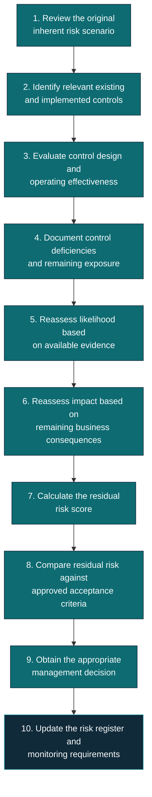

<a id="top"></a>

<div align="center">

# 🛡️ Solari Technologies Ltd.

### Security Control Validation & Residual Risk Assessment

**Phase 09 · Enterprise Cybersecurity Risk Assessment**


[Summary](#1-executive-summary) · [Methodology](#3-control-assessment-methodology) · [Validation Register](#5-enterprise-security-control-validation-register) · [Testing Procedures](#6-priority-security-control-testing-procedures) · [Evidence](#8-control-evidence-management) · [Residual Risk](#10-enterprise-residual-risk-register) · [Recommendations](#16-management-recommendations)

</div>

## 1. Executive Summary

This document establishes the proposed security control validation and residual risk assessment process for Solari Technologies Ltd., a technology and IT consulting organisation based in Lagos, Nigeria, with approximately 150 employees.

The assessment was prepared by **Simon Etim, GRC Analyst and Assessment Lead**, building on the cybersecurity risks identified in SOL-GRC-RA-005 and the treatment recommendations documented in SOL-GRC-RA-007.

The purpose of this assessment is to establish whether security controls adequately address identified risks and provide sufficient evidence to support residual risk ratings and management decisions.

### Assessment Summary

| Assessment Metric | Result | Distribution (15 risks) |
|---|:-:|:-:|
| Cybersecurity Risks Identified | **15** | `▓▓▓▓▓▓▓▓▓▓▓▓▓▓▓` |
| 🔴 Critical Inherent Risks | **4** | `▓▓▓▓░░░░░░░░░░░` |
| 🟠 High Inherent Risks | **10** | `▓▓▓▓▓▓▓▓▓▓░░░░░` |
| 🟡 Medium Inherent Risks | **1** | `▓░░░░░░░░░░░░░░` |
| 🟢 Low Inherent Risks | **0** | `░░░░░░░░░░░░░░░` |
| Risk Scenarios Requiring Control Validation | **15** | `▓▓▓▓▓▓▓▓▓▓▓▓▓▓▓` |
| Risk Scenarios With Validated Controls | **0** | `░░░░░░░░░░░░░░░` |
| Residual Risks Assessed | **0** | `░░░░░░░░░░░░░░░` |
| Residual Risk Assessments Pending | **15** | `▓▓▓▓▓▓▓▓▓▓▓▓▓▓▓` |

*Each block represents one of the 15 risks.*

> [!NOTE]
> **Assessment limitation:** This document establishes proposed control testing procedures. No actual control testing, evidence collection or residual risk validation has been performed.

---

## 2. Control Validation Objectives

The control validation process is designed to:

1. Determine whether security controls address identified cybersecurity risks.
2. Evaluate control design and implementation.
3. Assess operating effectiveness.
4. Identify control deficiencies and improvement opportunities.
5. Establish evidence-based residual risk ratings.
6. Support risk acceptance and management oversight.
7. Maintain traceability between risks, controls, evidence and treatment decisions.

---

## 3. Control Assessment Methodology

The proposed assessment approach draws on the principles of:

| Framework | Application |
|---|---|
| **ISO 31000:2018** | Risk evaluation, treatment and monitoring |
| **ISO/IEC 27005:2022** | Information security risk assessment and treatment |
| **ISO/IEC 27001:2022** | Information security risk treatment and control evaluation |
| **ISO/IEC 27002:2022** | Information security control guidance |
| **NIST CSF 2.0** | Cybersecurity governance and risk management |
| **NIST SP 800-53A Rev. 5** | Security and privacy control assessment procedures |

> [!NOTE]
> These frameworks provide methodological guidance. No formal certification or compliance assurance is claimed.

### 3.1 Control Assessment Dimensions

| Assessment Dimension | Description |
|---|---|
| **Design Effectiveness** | Determines whether the control is appropriately designed to address the identified risk |
| **Implementation Effectiveness** | Determines whether the control has been implemented as intended |
| **Operating Effectiveness** | Determines whether the control operates consistently over the assessment period |
| **Evidence Sufficiency** | Determines whether available evidence adequately supports the assessment conclusion |

> [!WARNING]
> A control should not be considered effective solely because it is documented or configured.

### 3.2 Control Testing Methods

| Testing Method | Description |
|---|---|
| **Examination** | Review policies, configurations, reports, records and supporting documentation |
| **Interview** | Obtain information from responsible control owners and relevant personnel |
| **Observation** | Observe control activities and operational processes |
| **Testing** | Perform authorised checks to determine whether controls operate as intended |
| **Reperformance** | Independently repeat selected control activities to verify results |
| **Sampling** | Evaluate representative records or transactions within a defined population |

Testing methods and sample sizes should reflect control criticality, frequency, population size and available evidence.

---

## 4. Control Effectiveness Classification

| Control Rating | Description |
|---|---|
| ✅ **Effective** | Control is appropriately designed, implemented and supported by sufficient operating evidence |
| 🟡 **Partially Effective** | Control addresses the risk but has limitations or inconsistent operation |
| 🔴 **Ineffective** | Control fails to adequately address the identified risk |
| ⚫ **Not Implemented** | Evidence confirms that the required control has not been implemented |
| ⚪ **Not Assessed** | Control effectiveness has not been evaluated or sufficient evidence is unavailable |

Control effectiveness ratings are separate from cybersecurity risk severity ratings.

> [!IMPORTANT]
> A control classified as **Not Assessed** must not automatically be treated as ineffective or effective.

---

## 5. Enterprise Security Control Validation Register

The following register establishes proposed validation activities for all 15 cybersecurity risk scenarios.

Control identifiers represent proposed assessment groups rather than verified individual controls.

**Current validation status:** All 15 control assessment groups are classified as ⚪ Not Assessed.

| Control ID | Risk ID | Control Area | Proposed Risk Owner | Inherent Risk |
|---|---|---|---|:-:|
| `CTL-001` | `RSK-001` | Authentication and phishing protection | Tunde Adebayo | 🟠 **16** |
| `CTL-002` | `RSK-002` | Privileged access management | Tunde Adebayo | 🔴 **20** |
| `CTL-003` | `RSK-003` | Client information access protection | Emeka Obi | 🟠 **12** |
| `CTL-004` | `RSK-004` | Remote management security | Emeka Obi | 🔴 **20** |
| `CTL-005` | `RSK-005` | Cloud security configuration | Tunde Adebayo | 🔴 **20** |
| `CTL-006` | `RSK-006` | Network security and segmentation | Tunde Adebayo | 🟠 **12** |
| `CTL-007` | `RSK-007` | Endpoint protection and patch management | Tunde Adebayo | 🟠 **16** |
| `CTL-008` | `RSK-008` | Security monitoring and logging | Amaka Nwosu | 🟠 **12** |
| `CTL-009` | `RSK-009` | Backup protection and recovery | Tunde Adebayo | 🟠 **15** |
| `CTL-010` | `RSK-010` | Employee information protection | Ngozi Eze | 🟠 **12** |
| `CTL-011` | `RSK-011` | Financial transaction controls | Ibrahim Bello | 🟠 **12** |
| `CTL-012` | `RSK-012` | Support platform access security | Emeka Obi | 🟠 **12** |
| `CTL-013` | `RSK-013` | Security policy governance | Funke Oladipo | 🟡 **9** |
| `CTL-014` | `RSK-014` | Privileged credential management | Amaka Nwosu | 🔴 **20** |
| `CTL-015` | `RSK-015` | Third-party security governance | Funke Oladipo | 🟠 **12** |

---

## 6. Priority Security Control Testing Procedures

*Select a control to expand or collapse its testing procedure.*

<details open>
<summary><b>CTL-002 — Privileged Access Management</b> · RSK-002 · 🔴 Critical (20/25)</summary>

<br>

| Field | Detail |
|---|---|
| **Associated Risk** | RSK-002 — Identity Infrastructure Compromise |
| **Inherent Risk** | 🔴 Critical (20/25) |
| **Risk Owner** | Tunde Adebayo |
| **Assessment Status** | ⚪ Not Assessed |
| **Control Objective** | Ensure privileged access to identity infrastructure is restricted to authorised personnel and appropriately monitored. |
| **Proposed Acceptance Criteria** | All in-scope privileged human accounts are appropriately authorised and protected by approved authentication controls. Emergency access accounts have documented compensating safeguards and monitoring. |
| **Control Effectiveness** | Not Assessed |
| **Residual Risk** | Pending |

**Proposed Controls**

- Phishing-resistant MFA.
- Privileged access management.
- Least-privilege access.
- Periodic administrative access reviews.
- Authentication monitoring.

**Proposed Testing Procedures**

1. Obtain the privileged account inventory.
2. Review administrative role assignments.
3. Examine MFA enforcement configurations.
4. Verify that privileged access is appropriately authorised.
5. Review periodic access certification records.
6. Examine authentication and administrative activity logs.
7. Document exceptions and control deficiencies.

**Required Evidence**

- Privileged account inventory.
- MFA configuration reports.
- Access approval records.
- Administrative role assignments.
- Access review documentation.
- Authentication logs.

</details>

<details>
<summary><b>CTL-004 — Remote Management Security</b> · RSK-004 · 🔴 Critical (20/25)</summary>

<br>

| Field | Detail |
|---|---|
| **Associated Risk** | RSK-004 — Remote Management Platform Compromise |
| **Inherent Risk** | 🔴 Critical (20/25) |
| **Risk Owner** | Emeka Obi |
| **Assessment Status** | ⚪ Not Assessed |
| **Control Objective** | Prevent unauthorised remote administration of managed systems and client environments. |
| **Proposed Acceptance Criteria** | Remote administrative access is authorised, appropriately restricted, protected by strong authentication and traceable through monitoring records. |
| **Control Effectiveness** | Not Assessed |
| **Residual Risk** | Pending |

**Proposed Controls**

- MFA for remote management access.
- Role-based access control.
- Administrative session monitoring.
- Restricted remote access.
- Periodic access reviews.

**Proposed Testing Procedures**

1. Review remote management platform configurations.
2. Obtain the inventory of authorised administrative accounts.
3. Verify MFA enforcement.
4. Examine role assignments and access restrictions.
5. Review administrative session logs.
6. Evaluate access review and account revocation procedures.

**Required Evidence**

- Remote management configuration reports.
- Administrative account inventory.
- MFA enforcement records.
- Session monitoring logs.
- Access review records.

</details>

<details>
<summary><b>CTL-005 — Cloud Security Configuration</b> · RSK-005 · 🔴 Critical (20/25)</summary>

<br>

| Field | Detail |
|---|---|
| **Associated Risk** | RSK-005 — Cloud Infrastructure Compromise |
| **Inherent Risk** | 🔴 Critical (20/25) |
| **Risk Owner** | Tunde Adebayo |
| **Assessment Status** | ⚪ Not Assessed |
| **Control Objective** | Protect cloud workloads and sensitive information against insecure configurations and unauthorised access. |
| **Proposed Acceptance Criteria** | Cloud resources comply with approved security baselines, access permissions are justified, and configuration exceptions are documented and appropriately managed. |
| **Control Effectiveness** | Not Assessed |
| **Residual Risk** | Pending |

**Proposed Controls**

- Secure cloud configuration baselines.
- Least-privilege access.
- Cloud security posture monitoring.
- Centralised security logging.
- Periodic configuration assessments.

**Proposed Testing Procedures**

1. Obtain the cloud asset inventory.
2. Review approved configuration baselines.
3. Examine cloud identity and access policies.
4. Review publicly accessible resources against approved business requirements.
5. Verify security logging configurations.
6. Examine cloud security posture assessment reports.
7. Review remediation records for identified configuration exceptions.

**Required Evidence**

- Cloud asset inventory.
- IAM policy exports.
- Configuration assessment reports.
- Cloud security posture reports.
- Security logging records.
- Remediation tickets.

</details>

<details>
<summary><b>CTL-014 — Privileged Credential Management</b> · RSK-014 · 🔴 Critical (20/25)</summary>

<br>

| Field | Detail |
|---|---|
| **Associated Risk** | RSK-014 — Privileged Credential Compromise |
| **Inherent Risk** | 🔴 Critical (20/25) |
| **Risk Owner** | Amaka Nwosu |
| **Assessment Status** | ⚪ Not Assessed |
| **Control Objective** | Protect privileged credentials and secrets against unauthorised disclosure, theft and misuse. |
| **Proposed Acceptance Criteria** | In-scope privileged secrets are securely stored, access is appropriately restricted, and credential lifecycle activities comply with approved requirements. |
| **Control Effectiveness** | Not Assessed |
| **Residual Risk** | Pending |

**Proposed Controls**

- Centralised secrets management.
- Restricted credential access.
- Credential rotation and revocation.
- MFA where supported.
- Privileged credential monitoring.

**Proposed Testing Procedures**

1. Obtain the inventory of in-scope privileged credentials and secrets.
2. Review approved credential management policies.
3. Examine secrets management configurations.
4. Verify credential access authorisation.
5. Review rotation and revocation records.
6. Examine privileged credential access logs.
7. Assess procedures for responding to credential exposure.

**Required Evidence**

- Secrets management configuration reports.
- Credential access policies.
- Authorisation records.
- Credential rotation records.
- Privileged access logs.
- Credential incident response procedures.

</details>

---

## 7. Additional Security Control Validation Activities

| Control ID | Risk ID | Proposed Validation Activity | Required Evidence |
|---|---|---|---|
| `CTL-001` | `RSK-001` | Verify authentication safeguards and phishing protection | MFA reports, email security policies and awareness records |
| `CTL-003` | `RSK-003` | Review client document access and sharing permissions | Access control lists and sharing audit logs |
| `CTL-006` | `RSK-006` | Evaluate network segmentation and firewall rules | Network diagrams, firewall configurations and authorised connectivity test results |
| `CTL-007` | `RSK-007` | Assess endpoint protection and patch compliance | EDR coverage reports, patch reports and exception records |
| `CTL-008` | `RSK-008` | Verify logging coverage and security alert effectiveness | SIEM source inventory, alert records and incident tickets |
| `CTL-009` | `RSK-009` | Evaluate backup isolation and recovery capabilities | Backup reports, restoration test records and recovery procedures |
| `CTL-010` | `RSK-010` | Review employee data access and protection | HR access records and data handling policies |
| `CTL-011` | `RSK-011` | Assess payment approvals and segregation of duties | Payment approval records and role assignments |
| `CTL-012` | `RSK-012` | Verify support platform authentication and access restrictions | MFA reports, user permissions and audit logs |
| `CTL-013` | `RSK-013` | Review security policy governance and communication | Approved policies, review dates and acknowledgement records |
| `CTL-015` | `RSK-015` | Assess vendor security due diligence | Vendor assessments, contracts and review records |

*All validation activities remain proposed and require appropriate authorisation before execution.*

---

## 8. Control Evidence Management

Control assessment conclusions must be supported by relevant, reliable and sufficient evidence.

### 8.1 Evidence Requirements

Evidence should be:

- Relevant to the control objective.
- Traceable to its original source.
- Appropriate for the assessment period.
- Sufficient to support the assessment conclusion.
- Protected against unauthorised access or modification.
- Handled in accordance with applicable confidentiality and data protection requirements.

### 8.2 Evidence Request Register

| Evidence ID | Control ID | Requested Evidence | Proposed Provider | Status |
|---|---|---|---|:-:|
| `EVD-001` | `CTL-002` | Privileged account inventory | IT Operations | ⚪ Pending |
| `EVD-002` | `CTL-002` | MFA configuration reports | IT Operations | ⚪ Pending |
| `EVD-003` | `CTL-004` | Remote management access logs | Managed Services | ⚪ Pending |
| `EVD-004` | `CTL-004` | Administrative access review records | Managed Services | ⚪ Pending |
| `EVD-005` | `CTL-005` | Cloud configuration assessment | IT Operations | ⚪ Pending |
| `EVD-006` | `CTL-005` | Cloud IAM policy exports | IT Operations | ⚪ Pending |
| `EVD-007` | `CTL-014` | Secrets management configuration | Cybersecurity | ⚪ Pending |
| `EVD-008` | `CTL-014` | Credential rotation records | Cybersecurity | ⚪ Pending |
| `EVD-009` | `CTL-009` | Backup restoration test records | IT Operations | ⚪ Pending |
| `EVD-010` | `CTL-008` | Security monitoring coverage reports | Cybersecurity | ⚪ Pending |

> [!NOTE]
> This register represents an initial set of priority evidence requirements. No evidence has actually been requested from or received from an organisation.

### 8.3 Control Testing Workpaper Template

<details>
<summary><b>View the workpaper template fields (16)</b></summary>

<br>

| Assessment Field | Required Information |
|---|---|
| **Test ID** | Unique control test identifier |
| **Control ID** | Associated security control |
| **Risk ID** | Associated cybersecurity risk |
| **Control Objective** | Intended security outcome |
| **Assessment Period** | Period covered by the assessment |
| **Testing Procedure** | Steps performed during validation |
| **Population** | Total records or assets subject to assessment |
| **Sample Size** | Number of items selected and justification |
| **Expected Result** | Defined control acceptance criteria |
| **Actual Result** | Observed testing outcome |
| **Evidence Reference** | Supporting evidence identifier |
| **Exceptions** | Identified deviations or deficiencies |
| **Control Rating** | Effectiveness assessment |
| **Assessor** | Person performing the assessment |
| **Reviewer** | Person reviewing the assessment |
| **Assessment Date** | Date testing was performed |

</details>

> [!WARNING]
> No workpaper should be marked complete without supporting evidence.

---

## 9. Residual Risk Assessment Methodology

Residual risk represents the cybersecurity exposure remaining after considering relevant existing and implemented controls.

```text
Residual Risk Score = Residual Likelihood × Residual Impact
```

Residual likelihood and impact are each rated from 1 to 5, consistent with SOL-GRC-RA-003.

### Standard Risk Classification

| Score | Risk Level | Colour Code | Management Response |
|:-:|:-:|:-:|---|
| 1–4 | 🟢 **Low** | `#16A34A` | Routine monitoring |
| 5–9 | 🟡 **Medium** | `#EAB308` | Planned treatment |
| 10–16 | 🟠 **High** | `#F97316` | Prioritised treatment |
| 17–25 | 🔴 **Critical** | `#DC2626` | Urgent escalation and treatment |

### 9.1 Residual Risk Assessment Process



### 9.2 Residual Risk Assessment Principles

- Proposed controls do not automatically reduce risk.
- Preventive controls may primarily reduce likelihood.
- Recovery and containment controls may reduce impact.
- Control effectiveness must not be converted into arbitrary risk score reductions.
- Residual ratings require documented justification.
- Insufficient evidence must be reflected in the assessment status.
- Risk acceptance must be authorised and documented.

---

## 10. Enterprise Residual Risk Register

**RL** = Residual Likelihood · **RI** = Residual Impact · **RS** = Residual Score

| Risk ID | Inherent Score | Control Effectiveness | RL | RI | RS | Residual Risk |
|---|:-:|:-:|:-:|:-:|:-:|:-:|
| `RSK-001` | 🟠 **16** | ⚪ Not Assessed | — | — | — | Pending |
| `RSK-002` | 🔴 **20** | ⚪ Not Assessed | — | — | — | Pending |
| `RSK-003` | 🟠 **12** | ⚪ Not Assessed | — | — | — | Pending |
| `RSK-004` | 🔴 **20** | ⚪ Not Assessed | — | — | — | Pending |
| `RSK-005` | 🔴 **20** | ⚪ Not Assessed | — | — | — | Pending |
| `RSK-006` | 🟠 **12** | ⚪ Not Assessed | — | — | — | Pending |
| `RSK-007` | 🟠 **16** | ⚪ Not Assessed | — | — | — | Pending |
| `RSK-008` | 🟠 **12** | ⚪ Not Assessed | — | — | — | Pending |
| `RSK-009` | 🟠 **15** | ⚪ Not Assessed | — | — | — | Pending |
| `RSK-010` | 🟠 **12** | ⚪ Not Assessed | — | — | — | Pending |
| `RSK-011` | 🟠 **12** | ⚪ Not Assessed | — | — | — | Pending |
| `RSK-012` | 🟠 **12** | ⚪ Not Assessed | — | — | — | Pending |
| `RSK-013` | 🟡 **9** | ⚪ Not Assessed | — | — | — | Pending |
| `RSK-014` | 🔴 **20** | ⚪ Not Assessed | — | — | — | Pending |
| `RSK-015` | 🟠 **12** | ⚪ Not Assessed | — | — | — | Pending |

> [!IMPORTANT]
> **Assessment conclusion:** Residual risk ratings cannot currently be established because sufficient control effectiveness evidence is unavailable.

---

## 11. Illustrative Residual Risk Assessment

The following example demonstrates how residual risk could be assessed if sufficient control evidence became available.

> [!CAUTION]
> **Hypothetical example only.** It is a worked illustration and must not be recorded as an actual assessment result.

### RSK-002 — Identity Infrastructure Compromise

| Assessment Component | Inherent Risk | Hypothetical Residual Risk |
|---|:-:|:-:|
| **Likelihood** | 4 – Likely | 2 – Unlikely |
| **Impact** | 5 – Severe | 5 – Severe |
| **Risk Score** | 20 | 10 |
| **Risk Classification** | 🔴 Critical | 🟠 High |

**Assumed Control Conditions**

- Phishing-resistant MFA is implemented for applicable privileged accounts.
- Privileged access is appropriately restricted.
- Administrative access reviews operate consistently.
- Authentication monitoring is effective.
- Supporting evidence has been independently reviewed.

| Item | Detail |
|---|---|
| **Illustrative Assessment Rationale** | Effective authentication and privileged access controls could reduce the likelihood of unauthorised administrative access. However, the potential consequences of a successful identity infrastructure compromise could remain severe. |
| **Hypothetical Risk Score Reduction** | 50% |
| **Proposed Management Response** | Continue prioritised treatment and monitoring because the hypothetical residual risk remains High. |

> [!WARNING]
> **Important:** The assumed controls and resulting residual score have not been verified. The official simulated risk register retains RSK-002 as residual risk pending.

---

## 12. Control Deficiency and Corrective Action Management

Identified control deficiencies should be documented and linked to the relevant risk scenarios.

### Corrective Action Register Template

<details>
<summary><b>View the corrective action register fields (14)</b></summary>

<br>

| Field | Description |
|---|---|
| **Finding ID** | Unique deficiency identifier |
| **Control ID** | Associated control |
| **Risk ID** | Associated cybersecurity risk |
| **Finding Description** | Observed control deficiency |
| **Supporting Evidence** | Evidence establishing the deficiency |
| **Root Cause** | Underlying reason for the deficiency |
| **Business Impact** | Potential consequence |
| **Risk Rating** | Assessed severity using the approved methodology |
| **Corrective Action** | Recommended improvement |
| **Action Owner** | Responsible individual or function |
| **Target Date** | Agreed completion date |
| **Status** | Current remediation position |
| **Retest Result** | Outcome of subsequent validation |
| **Closure Approval** | Authorised closure decision |

</details>

> [!NOTE]
> No actual control deficiencies have been recorded because testing has not been performed.

---

## 13. Risk Acceptance and Escalation

Residual risks should be evaluated against formally approved risk acceptance criteria.

### Proposed Risk Escalation Approach

| Residual Risk Level | Proposed Management Response |
|:-:|---|
| 🔴 **Critical** | Urgent executive escalation and further treatment |
| 🟠 **High** | Prioritised treatment and senior management review |
| 🟡 **Medium** | Scheduled treatment or authorised acceptance |
| 🟢 **Low** | Routine monitoring or authorised acceptance |

Risk acceptance decisions should document:

- Risk description and residual rating.
- Business justification.
- Relevant control limitations.
- Acceptance authority.
- Acceptance period and review date.
- Monitoring requirements.
- Conditions requiring reassessment.

> [!NOTE]
> No risk acceptance authority or decision has been formally approved within this simulation.

---

## 14. Control Monitoring and Reporting

The GRC Analyst should maintain ongoing visibility of control effectiveness and residual risk exposure.

### Proposed Key Performance and Risk Indicators

| Indicator | Measurement | Current Position |
|---|---|:-:|
| **Control Validation Coverage** | Risk scenarios with completed control validation ÷ 15 × 100 | 0% |
| **Evidence Collection Rate** | Evidence requests fulfilled ÷ total evidence requests × 100 | 0% |
| **Effective Control Rate** | Effective controls ÷ assessed controls × 100 | Not Available |
| **Residual Risk Assessment Coverage** | Risks with residual ratings ÷ 15 × 100 | 0% |
| **Corrective Action Closure Rate** | Validated closed actions ÷ total corrective actions × 100 | Not Available |
| **Critical Residual Risk Count** | Number of validated Critical residual risks | Unknown |
| **Overdue Treatment Actions** | Actions exceeding approved target dates | Not Available |

> [!WARNING]
> Indicators with unavailable denominators or unvalidated results must not be reported as zero.

Reporting frequency, performance targets and escalation thresholds require management approval.

---

## 15. Roles and Responsibilities

| Name | Role | Proposed Responsibility |
|---|---|---|
| **Simon Etim** | GRC Analyst & Assessment Lead | Coordinate validation, review evidence, assess risks and prepare reports |
| Tunde Adebayo | IT Operations Manager | Provide infrastructure, identity and recovery control evidence |
| Amaka Nwosu | Cybersecurity Team Lead | Provide security monitoring and credential protection evidence |
| Emeka Obi | Managed Services Manager | Provide remote management and client service control evidence |
| Funke Oladipo | Compliance Officer | Provide policy and third-party governance evidence |
| Ngozi Eze | HR Head | Provide employee information protection evidence |
| Ibrahim Bello | Finance Manager | Provide financial control evidence |
| Chinedu Okafor | CISO | Review assessment conclusions and coordinate risk escalation |
| Adewale Martins | CEO | Provide executive oversight and authorised resource decisions |

Where practicable, control validation should be reviewed independently of the personnel responsible for implementing the controls.

*All management stakeholders are fictional.*

---

## 16. Management Recommendations

Based on the simulated assessment, the following actions are recommended:

| # | Recommendation | Description |
|:-:|---|---|
| 1 | **Prioritise Critical Control Assessments** | Begin with identity infrastructure, remote management, cloud infrastructure and privileged credential management. |
| 2 | **Establish Evidence Requirements** | Define the documentation, configurations and operational records required for each assessment. |
| 3 | **Evaluate Control Effectiveness** | Assess control design, implementation and consistent operation. |
| 4 | **Track Control Deficiencies** | Assign corrective actions, proposed owners and agreed completion dates. |
| 5 | **Reassess Residual Risk** | Update risk ratings only when supported by sufficient evidence. |
| 6 | **Formalise Risk Acceptance** | Establish approval authorities and documented acceptance procedures. |
| 7 | **Maintain Continuous Monitoring** | Track control performance, treatment progress and changes in risk exposure. |

*All recommendations remain proposed.*

---

## 17. Assumptions and Limitations

This document is a simulated GRC portfolio deliverable.

- No actual security control testing has been performed.
- No live organisational systems have been accessed.
- No actual control evidence has been collected.
- Control assessment procedures and acceptance criteria are proposed.
- No actual control deficiencies have been confirmed.
- All inherent risk scores are illustrative.
- Residual risk ratings remain pending.
- The worked residual risk example is hypothetical.
- All management stakeholders are fictional.
- No formal risk acceptance or management approval has been obtained.

---

## 18. Review and Approval

| Name | Role | Status |
|---|---|---|
| **Simon Etim** | **GRC Analyst & Assessment Lead** | **🟢 Draft Prepared** |
| Tunde Adebayo | IT Operations Manager | 🟡 Pending Review |
| Amaka Nwosu | Cybersecurity Team Lead | 🟡 Pending Review |
| Emeka Obi | Managed Services Manager | 🟡 Pending Review |
| Funke Oladipo | Compliance Officer | 🟡 Pending Review |
| Chinedu Okafor | Chief Information Security Officer | ⚪ Approval Not Obtained |

---

## 19. Document Control

| Version | Date | Description |
|:-:|---|---|
| 1.0 | 24 November 2026 | Initial simulated security control validation and residual risk assessment methodology |

[Back to top](#top)

</div>
