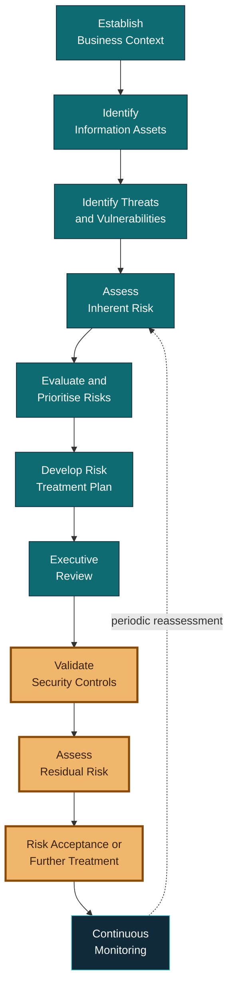
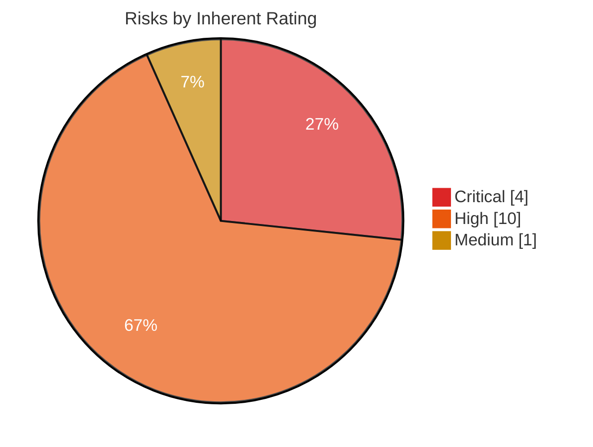

<a id="top"></a>

<div align="center">

# 🛡️ Enterprise Cybersecurity Risk Assessment

### Solari Technologies Ltd.

**Simon Etim · GRC Analyst & Assessment Lead**


[Overview](#1-project-overview) · [Methodology](#5-risk-assessment-methodology) · [Results](#6-assessment-results) · [Priority Risks](#7-priority-cybersecurity-risks) · [Deliverables](#8-project-deliverables) · [Skills](#11-skills-and-competencies-demonstrated)

</div>

## 1. Project Overview

Cybersecurity risk management goes beyond identifying technical vulnerabilities. It requires an understanding of business objectives, critical assets, potential threats, security controls and the consequences of risk exposure.

This project demonstrates a structured approach to conducting an enterprise cybersecurity risk assessment for Solari Technologies Ltd., a hypothetical technology and IT consulting organisation.

The assessment covers the risk management lifecycle, from establishing business context and identifying information assets to evaluating inherent risks, developing treatment recommendations and establishing control validation requirements.

The project was independently developed by **Simon Etim** to demonstrate practical competencies in Governance, Risk and Compliance, cybersecurity risk management and executive reporting.

---

## 2. Project Objectives

The primary objectives of this project are to:

1. Establish organisational context and assessment scope.
2. Identify and classify business-critical information assets.
3. Identify potential cybersecurity threats and vulnerabilities.
4. Assess and prioritise inherent cybersecurity risks.
5. Establish risk ownership and accountability.
6. Develop actionable risk treatment recommendations.
7. Communicate cybersecurity exposure to executive management.
8. Establish control validation and residual risk assessment procedures.

---

## 3. Frameworks and Standards

The project draws on recognised cybersecurity and risk management frameworks.

| Framework / Standard | Application |
|---|---|
| **ISO 31000:2018** | Enterprise risk management principles |
| **ISO/IEC 27005:2022** | Information security risk assessment and treatment |
| **ISO/IEC 27001:2022** | Information security management requirements |
| **ISO/IEC 27002:2022** | Information security control guidance |
| **NIST CSF 2.0** | Cybersecurity governance and risk management |
| **NIST SP 800-53A Rev. 5** | Security control assessment procedures |
| **Nigeria Data Protection Act 2023** | Relevant data protection considerations |

> [!NOTE]
> These frameworks provide methodological guidance. The project does not claim formal certification or regulatory compliance.

---

## 4. Assessment Scope

The assessment covers the following business and technology areas:

| Assessment Area | Coverage |
|---|---|
| **Identity & Access Management** | Active Directory, Microsoft Entra ID and privileged accounts |
| **Cloud Security** | Cloud infrastructure and access configurations |
| **Network Security** | Corporate network infrastructure and segmentation |
| **Endpoint Security** | Employee laptops and workstations |
| **Information Protection** | Client, employee and financial information |
| **Managed Services** | Remote management and client support platforms |
| **Security Operations** | Security monitoring, logging and incident detection |
| **Business Resilience** | Backup and recovery systems |
| **Security Governance** | Policies, procedures and accountability |
| **Third-Party Risk** | Vendor relationships and service dependencies |

---

## 5. Risk Assessment Methodology

The assessment uses a qualitative 5 × 5 likelihood and impact scoring model. Likelihood and impact are each rated on a scale of 1 to 5.

```text
Risk Score = Likelihood × Impact
```

### Standard Risk Classification

| Score | Risk Level | Colour Code | Management Response |
|:-:|:-:|:-:|---|
| 1–4 | 🟢 **Low** | `#16A34A` | Routine monitoring |
| 5–9 | 🟡 **Medium** | `#EAB308` | Planned treatment |
| 10–16 | 🟠 **High** | `#F97316` | Prioritised treatment |
| 17–25 | 🔴 **Critical** | `#DC2626` | Urgent escalation and treatment |

> [!NOTE]
> Risk ratings are illustrative and do not represent formally approved organisational risk appetite.

### Risk Management Lifecycle



*Teal steps are documented in this project. Amber steps (control validation, residual risk assessment, risk acceptance) are pending: the workflow represents the proposed lifecycle, and no actual control validation has been performed.*

---

## 6. Assessment Results

### Key Risk Indicators

| Assessment Metric | Result |
|---|:-:|
| Information Assets Identified | **15** |
| Cybersecurity Risk Scenarios Assessed | **15** |
| 🔴 Critical Inherent Risks | **4** |
| 🟠 High Inherent Risks | **10** |
| 🟡 Medium Inherent Risks | **1** |
| 🟢 Low Inherent Risks | **0** |
| Average Inherent Risk Score | **14.67 / 25** |
| High and Critical Risks | **93.3%** |
| Proposed Risk Treatment Entries | **15** |
| Proposed Control Assessment Groups | **15** |
| Validated Residual Risk Ratings | **0** |

### Risk Distribution

| Risk Level | Risks | Percentage | Distribution (15 risks) |
|:-:|:-:|:-:|:-:|
| 🔴 **Critical** | 4 | 26.7% | `▓▓▓▓░░░░░░░░░░░` |
| 🟠 **High** | 10 | 66.7% | `▓▓▓▓▓▓▓▓▓▓░░░░░` |
| 🟡 **Medium** | 1 | 6.7% | `▓░░░░░░░░░░░░░░` |
| 🟢 **Low** | 0 | 0% | `░░░░░░░░░░░░░░░` |

*Each block represents one of the 15 risks. Percentages are rounded.*



### Risk Heat Map

Likelihood runs down the left side and Impact runs across the top. Each cell shows how many risk scenarios sit at that position.

| Likelihood ↓ / Impact → | **1** | **2** | **3** | **4** | **5** |
|---|:-:|:-:|:-:|:-:|:-:|
| **5** – Almost Certain | 🟡 | 🟠 | 🟠 | 🔴 | 🔴 |
| **4** – Likely | 🟢 | 🟡 | 🟠 | 🟠 **2** | 🔴 **4** |
| **3** – Possible | 🟢 | 🟡 | 🟡 **1** | 🟠 **7** | 🟠 **1** |
| **2** – Unlikely | 🟢 | 🟢 | 🟡 | 🟡 | 🟠 |
| **1** – Rare | 🟢 | 🟢 | 🟢 | 🟢 | 🟡 |

🟢 Low &nbsp;·&nbsp; 🟡 Medium &nbsp;·&nbsp; 🟠 High &nbsp;·&nbsp; 🔴 Critical &nbsp;·&nbsp; Cells without a number contain no risks.

> [!WARNING]
> **Key observation:** 93.3% of the selected risk scenarios received High or Critical inherent ratings under the assessment assumptions. This does not establish actual organisational security exposure or verified residual risk.

---

## 7. Priority Cybersecurity Risks

The assessment identifies four Critical inherent risk scenarios requiring prioritised management consideration.

| Risk ID | Risk Description | Score | Priority |
|---|---|:-:|:-:|
| `RSK-002` | Identity Infrastructure Compromise | **20** | 🔴 Critical |
| `RSK-004` | Remote Management Platform Compromise | **20** | 🔴 Critical |
| `RSK-005` | Cloud Infrastructure Compromise | **20** | 🔴 Critical |
| `RSK-014` | Privileged Credential Compromise | **20** | 🔴 Critical |

### Recommended Security Priorities

- Strengthen identity and privileged access management.
- Improve remote administration security.
- Establish secure cloud configuration baselines.
- Strengthen privileged credential and secrets management.
- Improve endpoint and network security.
- Validate backup and recovery capabilities.
- Strengthen security monitoring and third-party oversight.

*All recommendations remain proposed.*

---

## 8. Project Deliverables

| Phase | Document ID | Deliverable | Status | Read |
|:-:|---|---|:-:|:-:|
| 01 | `SOL-GRC-RA-001` | Business Context & Scope | Drafted | [Open](SOL-GRC-RA-001-Business-Context-and-Scope.md) |
| 02 | `SOL-GRC-RA-002` | Information Asset Inventory & Classification | Drafted | [Open](SOL-GRC-RA-002-Information-Asset-Inventory.md) |
| 03 | `SOL-GRC-RA-003` | Cybersecurity Risk Assessment Methodology | Drafted | [Open](SOL-GRC-RA-003-Risk-Assessment-Methodology.md) |
| 04 | `SOL-GRC-RA-004` | Threat & Vulnerability Assessment | Drafted | [Open](SOL-GRC-RA-004-Threat-and-Vulnerability-Assessment.md) |
| 05 | `SOL-GRC-RA-005` | Enterprise Cybersecurity Risk Register | Drafted | [Open](SOL-GRC-RA-005-Cybersecurity-Risk-Register.md) |
| 06 | `SOL-GRC-RA-006` | Risk Heat Map & Analysis | Drafted | [Open](SOL-GRC-RA-006-Risk-Heat-Map.md) |
| 07 | `SOL-GRC-RA-007` | Enterprise Cybersecurity Risk Treatment Plan | Drafted | [Open](SOL-GRC-RA-007-Risk-Treatment-Plan.md) |
| 08 | `SOL-GRC-RA-008` | Executive Cybersecurity Risk Assessment Report | Drafted | [Open](SOL-GRC-RA-008-Executive-Risk-Assessment-Report.md) |
| 09 | `SOL-GRC-RA-009` | Security Control Validation & Residual Risk Assessment | Drafted | [Open](SOL-GRC-RA-009-Control-Validation-and-Residual-Risk-Assessment.md) |
| 10 | `SOL-GRC-RA-010` | Project Documentation & Quality Review | Drafted | – |

### Supporting Assessment Workbook

[`SOL-GRC-RA-Risk-Assessment-Workbook.xlsx`](SOL-GRC-RA-Risk-Assessment-Workbook.xlsx)

The supporting workbook is intended to provide a consolidated view of risk assessment data, scoring, prioritisation, treatment recommendations and management reporting.

---

## 9. Risk Treatment and Control Assurance

The project establishes a proposed risk treatment approach for all 15 identified cybersecurity risk scenarios.

Treatment recommendations are supported by:

- Proposed risk ownership.
- Prioritised security improvements.
- Control validation procedures.
- Evidence collection requirements.
- Control effectiveness assessment criteria.
- Residual risk assessment methodology.
- Risk acceptance and escalation procedures.

> [!WARNING]
> No security control implementation or operating effectiveness has been independently verified.

### Current Assessment Position

| Assessment Activity | Status |
|---|:-:|
| Business Context and Scope | ✅ Documented |
| Asset Identification | ✅ Documented |
| Threat and Vulnerability Identification | ✅ Documented |
| Inherent Risk Assessment | ✅ Completed – Simulated |
| Risk Prioritisation | ✅ Completed – Simulated |
| Risk Treatment Planning | ✅ Documented |
| Executive Reporting | ✅ Documented |
| Control Testing Procedures | ✅ Documented |
| Actual Control Validation | 🟡 Pending |
| Residual Risk Assessment | 🟡 Pending |
| Management Approval | ⚪ Not Obtained |

---

## 10. Tools and Technologies

| Tool / Technology | Application |
|---|---|
| **Microsoft Excel** | Risk register, scoring and assessment reporting |
| **GitHub** | Intended portfolio hosting and project documentation |
| **Markdown** | Structured technical and management documentation |
| **Mermaid** | Risk management process visualisation |
| **Risk Heat Maps** | Risk exposure and prioritisation visualisation |
| **Control Assessment Templates** | Evidence collection and control testing documentation |

---

## 11. Skills and Competencies Demonstrated

*Select a category to expand it.*

<details open>
<summary><b>Governance, Risk and Compliance</b></summary>

<br>

- Enterprise cybersecurity risk assessment.
- Risk identification, analysis and evaluation.
- Risk ownership and accountability.
- Risk treatment planning.
- Risk acceptance and escalation principles.
- Security governance documentation.
- Framework-based risk management.

</details>

<details>
<summary><b>Cybersecurity and Control Assurance</b></summary>

<br>

- Information asset identification and classification.
- Threat and vulnerability analysis.
- Identity and access management risk evaluation.
- Cloud and infrastructure security risk evaluation.
- Security control assessment planning.
- Control evidence requirements.
- Residual risk assessment methodology.

</details>

<details>
<summary><b>Business and Management Reporting</b></summary>

<br>

- Executive cybersecurity risk reporting.
- Translation of technical risks into business consequences.
- Risk dashboard development.
- Management decision support.
- Stakeholder responsibility mapping.
- Risk monitoring and performance indicators.

</details>

<details>
<summary><b>Documentation and Analytics</b></summary>

<br>

- Structured risk registers.
- Likelihood and impact scoring.
- Risk heat map development.
- Spreadsheet-based risk analysis.
- Document version control.
- Professional portfolio documentation.

</details>

---

## 12. Lessons Learned

The development of this project reinforces several important risk management principles.

| Principle | What it means |
|---|---|
| **Business context comes first** | Cybersecurity risks should be evaluated in relation to the business processes, information assets and objectives they could affect. |
| **Risk assessment is more than vulnerability identification** | A vulnerability becomes meaningful to management when its potential exploitation and business consequences are understood. |
| **Risk ownership matters** | Effective risk management requires clearly defined accountability across business and technical functions. |
| **Inherent and residual risk are different** | Proposed security controls cannot justify reduced residual risk ratings without sufficient evidence. |
| **Risk communication is essential** | Executive leadership needs clear information about business exposure, priorities, treatment options and decisions requiring attention. |
| **Risk management is continuous** | Changes in business operations, technology, threats and controls require periodic reassessment. |

---

## 13. Future Improvements

Future development of this project may include:

- A controlled laboratory environment for security control testing.
- Synthetic evidence for practical control assessment exercises.
- Detailed control mapping against ISO/IEC 27001 Annex A.
- Risk appetite and tolerance documentation.
- Interactive Power BI risk dashboards.
- Key risk indicator and key performance indicator reporting.
- Quantitative cybersecurity risk analysis.
- Risk acceptance and exception management templates.

> [!NOTE]
> Any future simulated testing results will be clearly distinguished from actual organisational findings.


<div align="center">

**Developed by Simon Etim** · GRC Analyst & Assessment Lead

*Connecting cybersecurity, business risk and governance.*
