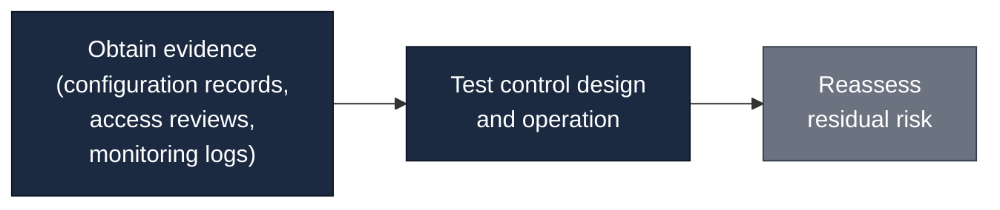

# 🛡️ Solari Technologies Ltd.

### Enterprise Cybersecurity Risk Treatment Plan

**Concise register · Enterprise Cybersecurity Risk Assessment**

   

     

[Register](#proposed-treatment-register) · [By Owner](#actions-by-owner) · [Validation](#governance-and-validation)

## Proposed treatment register

| Risk Level | Score | Actions | Distribution (15 risks) |
|:-:|:-:|:-:|:-:|
| 🔴 **Critical** | 17–25 | 4 | `▓▓▓▓░░░░░░░░░░░` |
| 🟠 **High** | 10–16 | 10 | `▓▓▓▓▓▓▓▓▓▓░░░░░` |
| 🟡 **Medium** | 5–9 | 1 | `▓░░░░░░░░░░░░░░` |
| 🟢 **Low** | 1–4 | 0 | `░░░░░░░░░░░░░░░` |
| **Total** | | **15** | `▓▓▓▓▓▓▓▓▓▓▓▓▓▓▓` |

*Each block represents one of the 15 risks.*

**Status of all 15 actions:** Proposed – not started.

| Risk ID | Asset |   Score (L × I)    | Priority | Treatment | Proposed owner |
|---|---| :-:  |:-:|---|---|
| **RSK‑001** | Microsoft 365 Environment | **16**  (4 × 4) | 🟠 High | Strengthen authentication and phishing protection | Tunde Adebayo |
| **RSK‑002** | Active Directory / Entra ID | **20** (4 × 5) | 🔴 Critical | Implement privileged access safeguards | Tunde Adebayo |
| **RSK‑003** | Client Project Documentation | **12** (3 × 4) | 🟠 High | Restrict and monitor client document access | Emeka Obi |
| **RSK‑004** | Remote Monitoring & Management Platform | **20** (4 × 5) | 🔴 Critical | Secure remote management access | Emeka Obi |
| **RSK‑005** | Cloud Infrastructure | **20** (4 × 5) | 🔴 Critical | Strengthen cloud security configurations | Tunde Adebayo |
| **RSK‑006** | Corporate Network Infrastructure | **12** (3 × 4) | 🟠 High | Improve segmentation and network configuration management | Tunde Adebayo |
| **RSK‑007** | Employee Laptops & Workstations | **16** (4 × 4) | 🟠 High | Improve patching and endpoint protection | Tunde Adebayo |
| **RSK‑008** | Security Monitoring / SIEM Platform | **12** (3 × 4) | 🟠 High | Improve security logging and alert coverage | Amaka Nwosu |
| **RSK‑009** | Backup & Recovery Systems | **15** (3 × 5) | 🟠 High | Protect backups and test restoration procedures | Tunde Adebayo |
| **RSK‑010** | Employee & Payroll Records | **12** (3 × 4) | 🟠 High | Strengthen employee data access controls | Ngozi Eze |
| **RSK‑011** | Financial & Billing Records | **12** (3 × 4) | 🟠 High | Strengthen payment verification and approval controls | Ibrahim Bello |
| **RSK‑012** | Client Support Ticketing System | **12** (3 × 4) | 🟠 High | Secure support platform authentication and permissions | Emeka Obi |
| **RSK‑013** | Security Policies & Procedures | **9** (3 × 3) | 🟡 Medium | Review and update security policies | Funke Oladipo |
| **RSK‑014** | Privileged Credentials & Secrets | **20** (4 × 5) | 🔴 Critical | Implement secure privileged credential management | Amaka Nwosu |
| **RSK‑015** | Vendor Contracts & Service Agreements | **12** (3 × 4) | 🟠 High | Strengthen vendor due diligence and security oversight | Funke Oladipo |

---

## Actions by owner

*Select an owner to see their actions, highest score first.*

<b>Tunde Adebayo</b> · IT Operations · 6 actions

 

| Risk ID | Score | Treatment |
|---|:-:|---|
| **RSK‑002** | 🔴 **20** | Implement privileged access safeguards |
| **RSK‑005** | 🔴 **20** | Strengthen cloud security configurations |
| **RSK‑001** | 🟠 **16** | Strengthen authentication and phishing protection |
| **RSK‑007** | 🟠 **16** | Improve patching and endpoint protection |
| **RSK‑009** | 🟠 **15** | Protect backups and test restoration procedures |
| **RSK‑006** | 🟠 **12** | Improve segmentation and network configuration management |

<b>Emeka Obi</b> · Managed Services · 3 actions

 

| Risk ID | Score | Treatment |
|---|:-:|---|
| **RSK‑004** | 🔴 **20** | Secure remote management access |
| **RSK‑003** | 🟠 **12** | Restrict and monitor client document access |
| **RSK‑012** | 🟠 **12** | Secure support platform authentication and permissions |

<b>Amaka Nwosu</b> · Cybersecurity · 2 actions

 

| Risk ID | Score | Treatment |
|---|:-:|---|
| **RSK‑014** | 🔴 **20** | Implement secure privileged credential management |
| **RSK‑008** | 🟠 **12** | Improve security logging and alert coverage |

<b>Funke Oladipo</b> · Compliance · 2 actions

 

| Risk ID | Score | Treatment |
|---|:-:|---|
| **RSK‑015** | 🟠 **12** | Strengthen vendor due diligence and security oversight |
| **RSK‑013** | 🟡 **9** | Review and update security policies |

<b>Ngozi Eze</b> · Human Resources · 1 action

 

| Risk ID | Score | Treatment |
|---|:-:|---|
| **RSK‑010** | 🟠 **12** | Strengthen employee data access controls |

<b>Ibrahim Bello</b> · Finance · 1 action

 

| Risk ID | Score | Treatment |
|---|:-:|---|
| **RSK‑011** | 🟠 **12** | Strengthen payment verification and approval controls |

---

## Governance and validation

> [!NOTE]
> Mitigation is proposed for all scenarios. Target dates require approval.

Obtain configuration records, access reviews, monitoring logs or other relevant evidence; test control design and operation before reassessing residual risk.

> [!WARNING]
> No implementation or acceptance is verified.
