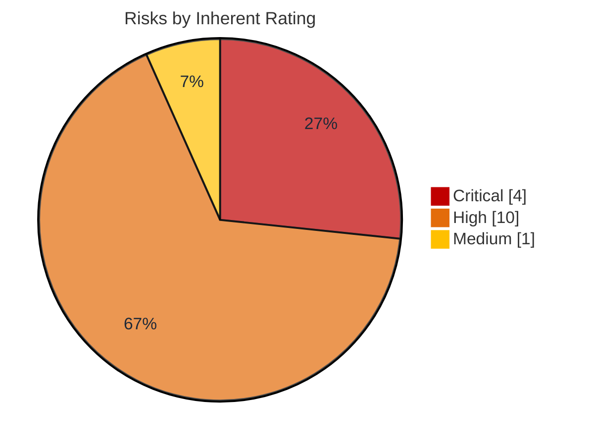

<a id="top"></a>

<div align="center">

# 🛡️ Solari Technologies Ltd.

### Enterprise Cybersecurity Risk Register

**Phase 05 · Enterprise Cybersecurity Risk Assessment**

   

      

[Register](#3-enterprise-cybersecurity-risk-register) · [Heat Map](#risk-heat-map) · [Explore by Level](#explore-the-register-by-severity) · [Priority Risks](#6-priority-risk-analysis) · [Treatment](#7-proposed-risk-treatment-register)

</div>

## 1. Executive Summary

This risk register documents 15 simulated cybersecurity risks associated with the information assets and business operations of Solari Technologies Ltd., a technology and IT consulting company based in Lagos, Nigeria, with approximately 150 employees.

The assessment was prepared by **Simon Etim, GRC Analyst and Assessment Lead**, using the risk methodology established in document SOL-GRC-RA-003.

The purpose of this register is to support risk visibility, prioritisation, accountability and treatment planning.

> [!NOTE]
> **Assessment limitation:** Risk ratings are scenario-based estimates. No actual security controls or vulnerabilities at Solari Technologies Ltd. have been verified.

---

## 2. Risk Assessment Methodology

Risks are evaluated using a 5 × 5 likelihood and impact matrix. Both likelihood and impact are rated from 1 to 5.

```text
Risk Score = Likelihood × Impact
```

### Standard Risk Classification

| Score | Risk Level | Colour Code | Response |
|:-:|:-:|:-:|---|
| 1–4 | 🟢 **Low** | `#16A34A` | Routine monitoring |
| 5–9 | 🟡 **Medium** | `#EAB308` | Planned treatment |
| 10–16 | 🟠 **High** | `#F97316` | Prioritised treatment |
| 17–25 | 🔴 **Critical** | `#DC2626` | Urgent escalation and treatment |

> [!NOTE]
> These thresholds are proposed for the portfolio simulation and are not formally approved organisational risk appetite.

---

## 3. Enterprise Cybersecurity Risk Register

**L** = Likelihood · **I** = Impact · **Score** = L × I

| Risk ID | Asset ID | Risk Description | L | I | Score | Inherent Risk |
|---|---|---|:-:|:-:|:-:|:-:|
| `RSK-001` | `AST-001` | Phishing-related Microsoft 365 account compromise | 4 | 4 | **16** | 🟠 HIGH |
| `RSK-002` | `AST-002` | Unauthorised privileged access to identity infrastructure | 4 | 5 | **20** | 🔴 CRITICAL |
| `RSK-003` | `AST-003` | Unauthorised disclosure of client project information | 3 | 4 | **12** | 🟠 HIGH |
| `RSK-004` | `AST-004` | Compromise of remote management platform | 4 | 5 | **20** | 🔴 CRITICAL |
| `RSK-005` | `AST-005` | Cloud infrastructure compromise or service disruption | 4 | 5 | **20** | 🔴 CRITICAL |
| `RSK-006` | `AST-006` | Network intrusion through insecure configuration | 3 | 4 | **12** | 🟠 HIGH |
| `RSK-007` | `AST-007` | Endpoint malware or ransomware infection | 4 | 4 | **16** | 🟠 HIGH |
| `RSK-008` | `AST-008` | Delayed detection due to inadequate security monitoring | 3 | 4 | **12** | 🟠 HIGH |
| `RSK-009` | `AST-009` | Backup compromise or recovery failure | 3 | 5 | **15** | 🟠 HIGH |
| `RSK-010` | `AST-010` | Unauthorised exposure of employee personal data | 3 | 4 | **12** | 🟠 HIGH |
| `RSK-011` | `AST-011` | Financial fraud or unauthorised payment changes | 3 | 4 | **12** | 🟠 HIGH |
| `RSK-012` | `AST-012` | Compromise of client support ticketing system | 3 | 4 | **12** | 🟠 HIGH |
| `RSK-013` | `AST-013` | Security policy governance failure | 3 | 3 | **9** | 🟡 MEDIUM |
| `RSK-014` | `AST-014` | Theft or misuse of privileged credentials | 4 | 5 | **20** | 🔴 CRITICAL |
| `RSK-015` | `AST-015` | Third-party security or service failure | 3 | 4 | **12** | 🟠 HIGH |

> [!WARNING]
> **Important:** These are illustrative inherent risk ratings. The likelihood and impact values are analytical assumptions, not measured incident probabilities or verified business impacts.

### Risk Heat Map

Likelihood runs down the left side and Impact runs across the top. Each cell shows its score and the risks placed there (`002` means RSK-002).

| Likelihood ↓ / Impact → | **1** Insignificant | **2** Minor | **3** Moderate | **4** Major | **5** Severe |
|---|:-:|:-:|:-:|:-:|:-:|
| **5** – Almost Certain | 🟡 | 🟠 | 🟠 | 🔴 | 🔴 |
| **4** – Likely | 🟢 | 🟡 | 🟠 | 🟠 **16**<br>`001` `007` | 🔴 **20**<br>`002` `004` `005` `014` |
| **3** – Possible | 🟢 | 🟡 | 🟡 **9**<br>`013` | 🟠 **12**<br>`003` `006` `008` `010`<br>`011` `012` `015` | 🟠 **15**<br>`009` |
| **2** – Unlikely | 🟢 | 🟢 | 🟡 | 🟡 | 🟠 |
| **1** – Rare | 🟢 | 🟢 | 🟢 | 🟢 | 🟡 |

🟢 Low &nbsp;·&nbsp; 🟡 Medium &nbsp;·&nbsp; 🟠 High &nbsp;·&nbsp; 🔴 Critical &nbsp;·&nbsp; Cells without Risk IDs are empty.

### Explore the register by severity

*Select a level to see its risks, highest score first.*

<details open>
<summary><b>🔴 Critical (4)</b> · score 17–25</summary>

<br>

| Risk / Asset | What could happen | L × I | Score | Proposed owner |
|---|---|:-:|:-:|---|
| **`RSK-002`**<br>Active Directory / Entra ID | Unauthorised privileged access to identity infrastructure | 4 × 5 | **20** / 25<br>`▓▓▓▓▓▓▓▓░░` | Tunde Adebayo<br>*IT Operations* |
| **`RSK-004`**<br>Remote Monitoring & Management Platform | Compromise of remote management platform | 4 × 5 | **20** / 25<br>`▓▓▓▓▓▓▓▓░░` | Emeka Obi<br>*Managed Services* |
| **`RSK-005`**<br>Cloud Infrastructure | Cloud infrastructure compromise or service disruption | 4 × 5 | **20** / 25<br>`▓▓▓▓▓▓▓▓░░` | Tunde Adebayo<br>*IT Operations* |
| **`RSK-014`**<br>Privileged Credentials & Secrets | Theft or misuse of privileged credentials | 4 × 5 | **20** / 25<br>`▓▓▓▓▓▓▓▓░░` | Amaka Nwosu<br>*Cybersecurity* |

</details>

<details>
<summary><b>🟠 High (10)</b> · score 10–16</summary>

<br>

| Risk / Asset | What could happen | L × I | Score | Proposed owner |
|---|---|:-:|:-:|---|
| **`RSK-001`**<br>Microsoft 365 Environment | Phishing-related Microsoft 365 account compromise | 4 × 4 | **16** / 25<br>`▓▓▓▓▓▓░░░░` | Tunde Adebayo<br>*IT Operations* |
| **`RSK-007`**<br>Employee Laptops & Workstations | Endpoint malware or ransomware infection | 4 × 4 | **16** / 25<br>`▓▓▓▓▓▓░░░░` | Tunde Adebayo<br>*IT Operations* |
| **`RSK-009`**<br>Backup & Recovery Systems | Backup compromise or recovery failure | 3 × 5 | **15** / 25<br>`▓▓▓▓▓▓░░░░` | Tunde Adebayo<br>*IT Operations* |
| **`RSK-003`**<br>Client Project Documentation | Unauthorised disclosure of client project information | 3 × 4 | **12** / 25<br>`▓▓▓▓▓░░░░░` | Emeka Obi<br>*Managed Services* |
| **`RSK-006`**<br>Corporate Network Infrastructure | Network intrusion through insecure configuration | 3 × 4 | **12** / 25<br>`▓▓▓▓▓░░░░░` | Tunde Adebayo<br>*IT Operations* |
| **`RSK-008`**<br>Security Monitoring / SIEM Platform | Delayed detection due to inadequate security monitoring | 3 × 4 | **12** / 25<br>`▓▓▓▓▓░░░░░` | Amaka Nwosu<br>*Cybersecurity* |
| **`RSK-010`**<br>Employee & Payroll Records | Unauthorised exposure of employee personal data | 3 × 4 | **12** / 25<br>`▓▓▓▓▓░░░░░` | Ngozi Eze<br>*Human Resources* |
| **`RSK-011`**<br>Financial & Billing Records | Financial fraud or unauthorised payment changes | 3 × 4 | **12** / 25<br>`▓▓▓▓▓░░░░░` | Ibrahim Bello<br>*Finance* |
| **`RSK-012`**<br>Client Support Ticketing System | Compromise of client support ticketing system | 3 × 4 | **12** / 25<br>`▓▓▓▓▓░░░░░` | Emeka Obi<br>*Managed Services* |
| **`RSK-015`**<br>Vendor Contracts & Service Agreements | Third-party security or service failure | 3 × 4 | **12** / 25<br>`▓▓▓▓▓░░░░░` | Funke Oladipo<br>*Compliance* |

</details>

<details>
<summary><b>🟡 Medium (1)</b> · score 5–9</summary>

<br>

| Risk / Asset | What could happen | L × I | Score | Proposed owner |
|---|---|:-:|:-:|---|
| **`RSK-013`**<br>Security Policies & Procedures | Security policy governance failure | 3 × 3 | **9** / 25<br>`▓▓▓▓░░░░░░` | Funke Oladipo<br>*Compliance* |

</details>

<details>
<summary><b>🟢 Low (0)</b> · score 1–4</summary>

<br>

No risks are rated Low.

</details>

---

## 4. Risk Ownership and Accountability

| Proposed Risk Owner | Department | Risks Owned | Count |
|---|---|---|:-:|
| **Tunde Adebayo** | IT Operations | `RSK-001` `RSK-002` `RSK-005` `RSK-006` `RSK-007` `RSK-009` | 6 |
| **Emeka Obi** | Managed Services | `RSK-003` `RSK-004` `RSK-012` | 3 |
| **Amaka Nwosu** | Cybersecurity | `RSK-008` `RSK-014` | 2 |
| **Funke Oladipo** | Compliance | `RSK-013` `RSK-015` | 2 |
| **Ngozi Eze** | Human Resources | `RSK-010` | 1 |
| **Ibrahim Bello** | Finance | `RSK-011` | 1 |
| **Total** | | | **15** |

<details>
<summary><b>View the proposed owner for each risk</b></summary>

<br>

| Risk ID | Proposed Risk Owner | Department |
|---|---|---|
| `RSK-001` | Tunde Adebayo | IT Operations |
| `RSK-002` | Tunde Adebayo | IT Operations |
| `RSK-003` | Emeka Obi | Managed Services |
| `RSK-004` | Emeka Obi | Managed Services |
| `RSK-005` | Tunde Adebayo | IT Operations |
| `RSK-006` | Tunde Adebayo | IT Operations |
| `RSK-007` | Tunde Adebayo | IT Operations |
| `RSK-008` | Amaka Nwosu | Cybersecurity |
| `RSK-009` | Tunde Adebayo | IT Operations |
| `RSK-010` | Ngozi Eze | Human Resources |
| `RSK-011` | Ibrahim Bello | Finance |
| `RSK-012` | Emeka Obi | Managed Services |
| `RSK-013` | Funke Oladipo | Compliance |
| `RSK-014` | Amaka Nwosu | Cybersecurity |
| `RSK-015` | Funke Oladipo | Compliance |

</details>

> [!NOTE]
> All risk ownership assignments are proposed for this simulated exercise and have not been accepted by actual stakeholders.

---

## 5. Risk Prioritisation Summary

| Risk Rating | Number of Risks | Percentage | Distribution (15 risks) |
|:-:|:-:|:-:|:-:|
| 🔴 **Critical** | 4 | 26.7% | `▓▓▓▓░░░░░░░░░░░` |
| 🟠 **High** | 10 | 66.7% | `▓▓▓▓▓▓▓▓▓▓░░░░░` |
| 🟡 **Medium** | 1 | 6.7% | `▓░░░░░░░░░░░░░░` |
| 🟢 **Low** | 0 | 0% | `░░░░░░░░░░░░░░░` |
| **Total** | **15** | **100%** | `▓▓▓▓▓▓▓▓▓▓▓▓▓▓▓` |

*Each block represents one of the 15 risks.*



> [!IMPORTANT]
> **Key observation:** Four simulated risks have Critical inherent ratings and warrant priority consideration in the proposed risk treatment plan.

---

## 6. Priority Risk Analysis

*Select a risk to expand or collapse its details.*

<details open>
<summary><b>RSK-002 — Identity Infrastructure Compromise</b> · 🔴 Critical (20/25)</summary>

<br>

| Field | Detail |
|---|---|
| **Inherent Risk** | 🔴 CRITICAL (20/25) |
| **Risk Owner** | Tunde Adebayo |
| **Scenario** | A threat actor exploits weak privileged access controls to gain unauthorised administrative access to Active Directory or Microsoft Entra ID. |
| **Potential Business Impact** | Compromise of identity services, unauthorised access to business systems and disruption of operations. |

**Proposed Controls**

- Phishing-resistant MFA for privileged access.
- Privileged access management.
- Least-privilege access.
- Periodic privileged account reviews.
- Centralised authentication monitoring.

</details>

<details>
<summary><b>RSK-004 — Remote Management Platform Compromise</b> · 🔴 Critical (20/25)</summary>

<br>

| Field | Detail |
|---|---|
| **Inherent Risk** | 🔴 CRITICAL (20/25) |
| **Risk Owner** | Emeka Obi |
| **Scenario** | Compromised administrative credentials allow unauthorised remote access to managed endpoints. |
| **Potential Business Impact** | Client service disruption, unauthorised system changes and contractual exposure. |

**Proposed Controls**

- MFA for remote management access.
- Role-based access controls.
- Administrative session monitoring.
- Restriction of remote management access.
- Regular review of privileged accounts.

</details>

<details>
<summary><b>RSK-005 — Cloud Infrastructure Compromise</b> · 🔴 Critical (20/25)</summary>

<br>

| Field | Detail |
|---|---|
| **Inherent Risk** | 🔴 CRITICAL (20/25) |
| **Risk Owner** | Tunde Adebayo |
| **Scenario** | Misconfigured cloud access policies or exposed services allow unauthorised access to sensitive workloads. |
| **Potential Business Impact** | Data exposure, service downtime and business interruption. |

**Proposed Controls**

- Cloud security posture management.
- Secure configuration baselines.
- Least-privilege cloud access.
- Centralised logging.
- Continuous configuration monitoring.

</details>

<details>
<summary><b>RSK-014 — Privileged Credential Compromise</b> · 🔴 Critical (20/25)</summary>

<br>

| Field | Detail |
|---|---|
| **Inherent Risk** | 🔴 CRITICAL (20/25) |
| **Risk Owner** | Amaka Nwosu |
| **Scenario** | Privileged credentials are stolen or exposed through insecure storage or credential reuse. |
| **Potential Business Impact** | Unauthorised system administration, data compromise and disruption of critical infrastructure. |

**Proposed Controls**

- Centralised secrets management.
- Privileged access management.
- Credential rotation and revocation.
- MFA where supported.
- Monitoring of privileged account activity.

</details>

---

## 7. Proposed Risk Treatment Register

| Risk ID | Proposed Treatment | Priority |
|---|---|:-:|
| `RSK-001` | Strengthen authentication and phishing protection | 🟠 High |
| `RSK-002` | Implement privileged access safeguards | 🔴 Critical |
| `RSK-003` | Restrict and monitor client document access | 🟠 High |
| `RSK-004` | Secure remote management access | 🔴 Critical |
| `RSK-005` | Strengthen cloud security configurations | 🔴 Critical |
| `RSK-006` | Improve segmentation and network configuration management | 🟠 High |
| `RSK-007` | Improve patching and endpoint protection | 🟠 High |
| `RSK-008` | Improve security logging and alert coverage | 🟠 High |
| `RSK-009` | Protect backups and test restoration procedures | 🟠 High |
| `RSK-010` | Strengthen employee data access controls | 🟠 High |
| `RSK-011` | Strengthen payment verification and approval controls | 🟠 High |
| `RSK-012` | Secure support platform authentication and permissions | 🟠 High |
| `RSK-013` | Review and update security policies | 🟡 Medium |
| `RSK-014` | Implement secure privileged credential management | 🔴 Critical |
| `RSK-015` | Strengthen vendor due diligence and security oversight | 🟠 High |

*All actions are recommendations. No remediation implementation is claimed.*

---

## 8. Existing Controls and Residual Risk

The effectiveness of existing security controls has not been established. Therefore:

| Item | Current Status |
|---|---|
| **Inherent risk** | ✅ Estimated for all 15 scenarios |
| **Existing controls** | ⚪ Not verified |
| **Residual likelihood** | ⚪ Not assessed |
| **Residual impact** | ⚪ Not assessed |
| **Residual risk rating** | 🟡 Pending control validation |

> [!WARNING]
> Residual risk must not be reduced based solely on proposed controls.

A separate control assessment and risk treatment exercise will establish justified residual risk estimates.

---

## 9. Risk Monitoring and Reporting

The GRC Analyst will maintain the simulated risk register and prepare management reporting covering:

- Risk distribution by severity.
- Critical and High risks requiring attention.
- Risk ownership and accountability.
- Treatment progress and overdue actions.
- Changes in risk exposure.
- Residual risks after validated controls.

### Proposed Review Frequency

| Risk Level | Review Approach |
|:-:|---|
| 🔴 **Critical** | Frequent management oversight |
| 🟠 **High** | Prioritised management review |
| 🟡 **Medium** | Scheduled review |
| 🟢 **Low** | Routine monitoring |

> [!NOTE]
> Review frequencies and escalation deadlines require formal approval for real-world use.

---

## 10. Assumptions and Limitations

This register is a simulated portfolio deliverable.

- No actual security vulnerabilities were verified.
- No live risk workshops or stakeholder interviews were conducted.
- Likelihood and impact scores are illustrative.
- Risk ownership has not been formally accepted.
- Existing control effectiveness is unknown.
- Residual risks remain unassessed.
- All management stakeholders are fictional.

---

## 11. Review and Approval

| Name | Role | Status |
|---|---|---|
| **Simon Etim** | **GRC Analyst & Assessment Lead** | **🟢 Draft Prepared** |
| Tunde Adebayo | IT Operations Manager | 🟡 Pending Review |
| Amaka Nwosu | Cybersecurity Team Lead | 🟡 Pending Review |
| Chinedu Okafor | Chief Information Security Officer | ⚪ Approval Not Obtained |

---

## 12. Document Control

| Version | Date | Description |
|:-:|---|---|
| 1.0 | 22 November 2026 | Initial simulated cybersecurity risk register |
